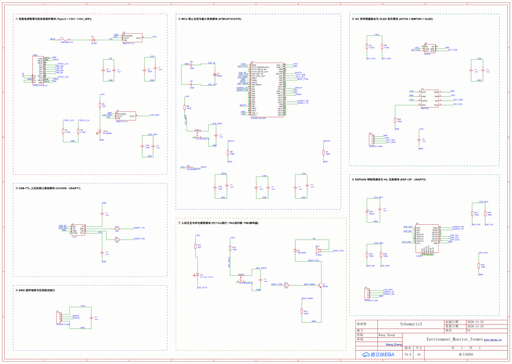
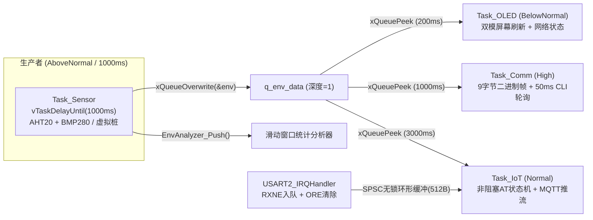

# 基于 STM32F103 的嵌入式多任务智能环境监测系统 (v4.0 IoT 全栈与软硬协同版)

[](https://github.com/jvjjjj/Environment_Monitor/tree/v4.0)
[](https://www.st.com)
[](https://www.freertos.org)
[]()
[]()
[%20V6.24-purple.svg)](https://developer.arm.com)

> 💡 **项目演进导读**：本项目是一套从零构建的工业级嵌入式环境监测终端，完整历经四个递进演进阶段：
> * **v1.0（裸机驱动与总线复用）**：软件模拟 I2C、开漏上拉阻抗匹配、OLED 1KB 显存双缓冲与 AHT20 温湿度采集（见分支 [`v1.0`](https://github.com/jvjjjj/Environment_Monitor/tree/v1.0) / [`v1`](https://github.com/jvjjjj/Environment_Monitor/tree/v1)）。
> * **v2.0（通信协议与上位机交互）**：自主设计 9 字节定长二进制协议帧、定点化大端序传输与 Python (PySerial + Matplotlib) 滑窗波形上位机（见分支 [`v2.0`](https://github.com/jvjjjj/Environment_Monitor/tree/v2.0)）。
> * **v3.0（实时操作系统与双传感融合）**：移植 FreeRTOS 抢占式内核、TIM4 与 SysTick 硬件时基解耦、BMP280 双地址（`0x76/0x77`）自适应探测与 64 位气压补偿（见分支 [`v3.0`](https://github.com/jvjjjj/Environment_Monitor/tree/v3.0)）。
> * **v4.0（当前版本 / [`master`](https://github.com/jvjjjj/Environment_Monitor) / [`v4.0`](https://github.com/jvjjjj/Environment_Monitor/tree/v4.0)）**：**物联网全栈、高并发无锁缓冲与立创 EDA 硬件全板设计**。融合 v3.0 全部传感与协议能力，新增 **ESP8266 SPSC 免锁环形缓冲区**、**USART2 ORE 硬件防死锁**、**非阻塞 AT+MQTT 指数退避重连**、**虚拟传感器桩 + CLI 故障注入 + 滑动窗口分析器**、**单串口 HIL 硬件在环网关 + Web 监控大屏**，以及通过立创 EDA 原生 DRC 0 报错的 **v4.0 完整原理图与 66 器件 BOM**。

---

## 目录 (Table of Contents)

1. [演进全景与版本能力对比 (v1.0 ~ v4.0)](#1-演进全景与版本能力对比-v10--v40)
2. [v4.0 硬件原理图与外设拓扑](#2-v40-硬件原理图与外设拓扑)
3. [FreeRTOS 四任务并发架构与无损共享机制](#3-freertos-四任务并发架构与无损共享机制)
4. [核心源码与工程亮点深度剖析](#4-核心源码与工程亮点深度剖析)
   * [4.1 SPSC 免锁环形缓冲区与 USART2 ORE 防死锁 (`esp8266.c` / `stm32f1xx_it.c`)](#41-spsc-免锁环形缓冲区与-usart2-ore-防死锁-esp8266c--stm32f1xx_itc)
   * [4.2 非阻塞 AT+MQTT 状态机、JSON 转义与指数退避重连 (`esp8266.c` / `freertos.c`)](#42-非阻塞-atmqtt-状态机json-转义与指数退避重连-esp8266c--freertosc)
   * [4.3 双传感器融合、3 阶泰勒海拔换算与 9 脉冲总线自愈 (`bmp280.c` / `i2c.c`)](#43-双传感器融合3-阶泰勒海拔换算与-9-脉冲总线自愈-bmp280c--i2cc)
   * [4.4 9 字节定长二进制协议帧与 CLI 调试控制台 (`protocol.c` / `debug_console.c`)](#44-9-字节定长二进制协议帧与-cli-调试控制台-protocolc--debug_consolec)
   * [4.5 虚拟传感器桩与滑动窗口趋势分析 (`virtual_sensor.c` / `env_analyzer.c`)](#45-虚拟传感器桩与滑动窗口趋势分析-virtual_sensorc--env_analyzerc)
5. [快速上手：编译构建、烧录与 HIL 端云联调](#5-快速上手编译构建烧录与-hil-端云联调)
6. [现场软硬件排障实录 (Troubleshooting)](#6-现场软硬件排障实录-troubleshooting)
7. [仓库目录结构导航](#7-仓库目录结构导航)

---

## 1. 演进全景与版本能力对比 (v1.0 ~ v4.0)

| 演进维度 | [v1.0 裸机基础版](https://github.com/jvjjjj/Environment_Monitor/tree/v1.0) | [v2.0 协议交互版](https://github.com/jvjjjj/Environment_Monitor/tree/v2.0) | [v3.0 RTOS 融合版](https://github.com/jvjjjj/Environment_Monitor/tree/v3.0) | **v4.0 全栈协同版 (当前)** |
| :--- | :--- | :--- | :--- | :--- |
| **调度架构** | `while(1)` 单循环阻塞轮询 | 顺序采样 + 异步串口封包 | FreeRTOS 3 任务 (`xQueueReceive`) | **FreeRTOS 4 任务 + `xQueueOverwrite` / `xQueuePeek` 无损共享** |
| **传感器** | AHT20 温湿度 | AHT20 温湿度 | AHT20 + BMP280 (气压/海拔) | **AHT20 + BMP280 + 虚拟传感器桩（硬件缺失自动降级）** |
| **时基配置** | SysTick 供 `HAL_Delay` | SysTick 供 `HAL_Delay` | SysTick 供 RTOS + TIM4 供 HAL | **SysTick 供 RTOS + TIM4 供 HAL + `vTaskDelayUntil` 精确周期** |
| **本地交互** | OLED 1KB 双缓冲显存 | OLED + 上位机波形 | OLED 四行自诊断显示 | **OLED 双模监视器 + USART1 CLI 故障注入 + 滑动窗口统计** |
| **通信链路** | 内部 I2C 点阵数据 | 9 字节二进制帧 (USART1) | 9 字节二进制帧 (USART1) | **USART1 9 字节二进制帧 + USART2 ESP8266 AT+MQTT 遥测** |
| **缓冲与容错** | 软件 I2C 超时退出 | 帧头 + 累加和过滤误码 | BMP280 双地址探测 + 掉线自愈 | **512B SPSC 无锁队列 + ORE 清除 + 9 脉冲 I2C 复位 + 指数退避** |
| **硬件设计** | 面包板杜邦线搭接 | 面包板 + CH340 模块 | 面包板多从机上拉优化 | **立创 EDA 7 分区全板原理图 + 66 器件完整 BOM (`DRC 0 Error`)** |

---

## 2. v4.0 硬件原理图与外设拓扑

### 2.1 主控与引脚资源映射
- **主控芯片**：`STM32F103C8T6`（ARM Cortex-M3 / 72MHz / 64KB Flash / 20KB SRAM）
- **I2C1 总线 (`PB6` SCL / `PB7` SDA)**：外挂 `4.7kΩ ±1%` 上拉电阻，并联 `AHT20 (0x38)`、`BMP280 (0x76/0x77)` 与 `0.96 寸 OLED (0x3C)`。
- **USART1 (`PA9` TX / `PA10` RX, 115200 8-N-1)**：经 `CH340N`（串接 `1kΩ` 限流保护电阻）连接 PC，承载 9 字节二进制协议帧与 CLI 调试指令。
- **USART2 (`PA2` TX / `PA3` RX, 115200 8-N-1)**：连接 `ESP-12F (ESP8266)` Wi-Fi 模组，并同步引出 `1×4P` HIL 单串口仿真排针。
- **人机交互与调试**：`PA13/PA14`（SWD）、`PC13`（低有效心跳灯）、`PA0`（RC 硬件消抖用户键）、`PB5`（`S8050 + 1N4148W` 驱动有源蜂鸣器）。

### 2.2 v4.0 原理图全景与核心电气设计
> 完整物料清单见 [BOM_STM32_Env_Monitor_v4_0.xlsx](./BOM_STM32_Env_Monitor_v4_0.xlsx)，PCB 约束文件见 [pcb-project.json](./pcb-project.json)。



- **双轨独立供电抗欠压复位（BOR）**：Type-C `VBUS` 经 `1.1A PTC (F1)` 与 `SS34F` 肖特基防反接后，拆分为两路 `AMS1117-3.3`——`U2` 专供主控与传感器（`+3V3`），`U4` 专供 `ESP-12F`（`+3V3_WIFI`），全板单点共地。Wi-Fi 供电脚就近并联 `220μF` 低 ESR（`35mΩ`）钽电容与 `100nF` 瓷片电容，抑制 PA 突发 `~300mA` 电流引起的电压跌落（理论瞬态压降 `<80mV`）。
- **模拟电源与保护**：`VDDA` 经 `600Ω@100MHz` 磁珠与 `10μF + 100nF` 滤波；Type-C `CC1/CC2` 各接 `5.1kΩ` 下拉电阻确保 C-to-C 5V 受电识别。

---

## 3. FreeRTOS 四任务并发架构与无损共享机制

系统在 [Core/Src/freertos.c](./Core/Src/freertos.c) 中创建 4 个协同任务，**彻底摒弃全局共享变量竞态**，通过深度为 1 的队列 `q_env_data` 实现单生产者-多消费者无损共享：



| 任务句柄 | 优先级 | 栈大小 (Words) | 执行周期 | 核心职责 |
| :--- | :---: | :---: | :---: | :--- |
| `Task_Comm` | `osPriorityHigh` | `256` (1KB) | `50ms` 步进 / `1000ms` 上传 | 处理 USART1 CLI 调试命令、翻转 `PC13` 心跳灯、发送 9 字节二进制协议帧 |
| `Task_Sensor` | `osPriorityAboveNormal` | `256` (1KB) | `1000ms` (`vTaskDelayUntil`) | 采集 AHT20 + BMP280（故障自动降级虚拟桩 + 9 脉冲自愈），更新滑窗统计 |
| `Task_IoT` | `osPriorityNormal` | `320` (1.25KB) | `3000ms` 遥测 / 退避重连 | 驱动 ESP8266 四阶段非阻塞状态机、JSON 转义发布 MQTT、断网指数退避 |
| `Task_OLED` | `osPriorityBelowNormal` | `256` (1KB) | `200ms` | 非破坏性读取最新环境帧与 `g_net_state`，刷新 128×64 SSD1306 双缓冲显存 |

---

## 4. 核心源码与工程亮点深度剖析

### 4.1 SPSC 免锁环形缓冲区与 USART2 ORE 防死锁 (`esp8266.c` / `stm32f1xx_it.c`)
- **Fast-In Slow-Out 分离**：`USART2_IRQHandler` 仅调用 `ESP8266_RxCallback()` 读取 `DR` 寄存器并写入 512 字节 `s_rx_buf`，单次中断执行 `<1μs`；`Task_IoT` 在任务上下文中消费数据。
- **SPSC 免锁安全**：中断（生产者）仅写 `s_rx_head`，任务（消费者）仅写 `s_rx_tail`。在 Cortex-M3 架构下 16 位对齐读写具备指令级原子性，配合 `volatile` 即可实现无锁线程安全，无需关中断或 Mutex。
- **ORE 溢出防死锁**：115200bps 突发数据易触发硬件 Overrun (`ORE`)，若不清除将导致硬件永久关闭 `RXNE` 中断。`stm32f1xx_it.c` 中显式执行 `__HAL_UART_CLEAR_OREFLAG(&huart2)` 实现自动自愈。

### 4.2 非阻塞 AT+MQTT 状态机、JSON 转义与指数退避重连 (`esp8266.c` / `freertos.c`)
- **20ms 步进让渡**：`ESP8266_SendCmd()` 每次循环调用 `vTaskDelay(pdMS_TO_TICKS(20))` 主动交出 CPU，杜绝死等卡死传感器采集与屏幕刷新。
- **四阶段状态机与回显抑制**：握手成功即发 `ATE0` 关闭本地回显，依次推进 `WAIT AT` $\to$ `WIFI CON` $\to$ `MQTT CON` $\to$ `MQTT ONLINE`；对标准指令 `AT+MQTTPUB=0,"topic","...",0,0` 内的 JSON 双引号执行自动转义（`"` $\to$ `\"`）。
- **指数退避容灾**：建连失败或连续 3 次发布失败时进入 `NET_STATE_FAIL`，退避周期按 `1s → 2s → 4s → 8s → 16s → 30s` 翻倍，避免弱网雪崩重连；重连成功立即复位回 `1s`。

### 4.3 双传感器融合、3 阶泰勒海拔换算与 9 脉冲总线自愈 (`bmp280.c` / `i2c.c`)
- **BMP280 双地址探测与 64-bit 补偿**：开机自动探测 `0x76` / `0x77` 并校验 Chip ID（兼容 `0x58`/`0x60`/`0x56`/`0x57`），读取 24 字节出厂标定系数后执行 Bosch 官方 64 位定点补偿公式。
- **无 FPU 体积优化**：Cortex-M3 无硬件 FPU，直接调用 `powf()` 会引入约 `4.5KB` 软浮点数学库。[bmp280.c](./Core/Src/bmp280.c) 采用国际标准气压公式在 $x = 1 - P/P_0$ 处的 **3 阶泰勒展开** 估算海拔（0~3000m 误差 `<0.3m`），显著压缩 Flash 占用。
- **I2C1 9 脉冲自愈**：连续 3 次 I2C 读取失败时，`I2C1_BusRecovery_9Pulse()` 临时将 `PB6/PB7` 切回开漏 GPIO，输出最多 9 个 SCL 脉冲释放被从机锁死的 SDA 并补发 `STOP`，随后重新初始化 `MX_I2C1_Init()`。

### 4.4 9 字节定长二进制协议帧与 CLI 调试控制台 (`protocol.c` / `debug_console.c`)
- **二进制协议帧格式 (`115200 8-N-1`)**：`[0xAA][0x55][0x01][Temp_H][Temp_L][Humi_H][Humi_L][Checksum][0x0D]`，温度/湿度放大 10 倍转为大端序 16 位整型，相比纯 ASCII 文本节省近 **50% 带宽** 并规避浮点序列化歧义。
- **CLI 实时交互指令**：通过 `USART1` 发送指令即可在线干预系统运行与诊断（支持 `temp <val>`、`hum <val>`、`auto`、`read`、`stat`、`hist`、`proto on` / `proto off`、`help`）。

### 4.5 虚拟传感器桩与滑动窗口趋势分析 (`virtual_sensor.c` / `env_analyzer.c`)
- 在 [Core/Inc/main.h](./Core/Inc/main.h) 中设置 `ENV_FORCE_VIRTUAL_SENSOR`（`0` 为硬件优先、缺硬件自动降级；`1` 为强制台架仿真模式），无需物理传感器即可在桌面完成全链路验证；`env_analyzer` 维护滑动窗口计算 `MAX / MIN / AVG` 与温度变化趋势（`Rising` / `Falling` / `Stable`）。

---

## 5. 快速上手：编译构建、烧录与 HIL 端云联调

### 5.1 编译与烧录（Keil MDK 5 / ARMCLANG AC6）
1. 打开工程 `MDK-ARM/new_Env_Monitor.uvprojx`（使用 **ARMCLANG V6.24**，`-Oz` 优化 + MicroLIB）。
2. 全量编译结果为 **`0 Error(s), 0 Warning(s)`**（Code `26288 B` + RO-data `3168 B` + RW/ZI `13008 B`）。
3. 通过 ST-Link V2（SWD）烧录生成的 `.hex` / `.axf` 固件至 `STM32F103C8T6`。

### 5.2 单串口 HIL 硬件在环与网页大屏联调
1. 安装 Python 依赖：
   ```bash
   pip install pyserial paho-mqtt
   ```
2. 修改 [virtual_esp8266_gateway.py](./virtual_esp8266_gateway.py) 中的 `SERIAL_PORT` 为本机串口号后启动虚拟网关：
   ```bash
   python virtual_esp8266_gateway.py
   ```
3. 浏览器直接打开 [dashboard.html](./dashboard.html)（基于 `MQTT.js` + `Chart.js` 直连 `broker.emqx.io`），即可实时查看温湿度曲线与告警状态，并反向向单片机下发控制指令。

---

## 6. 现场软硬件排障实录 (Troubleshooting)

1. **ESP8266 联网瞬间触发主控欠压复位 (Brown-out Reset)**
   - **根因**：ESP8266 在 `AT+CWJAP` 阶段 PA 突发电流达 `~300mA`，单路小功率 LDO 被拉跌近 `1V` 触发 STM32 BOR。
   - **解决**：硬件改用双路独立 `AMS1117-3.3` 分轨供电并在 Wi-Fi 端并联 `220μF` 低 ESR 钽电容，压降收敛至 `<80mV`。
2. **Keil 链接报 `L6047U` / Flash 体积超限**
   - **根因**：`bmp280.c` 引入 `<math.h>` 的 `powf()` 导致无 FPU 的 Cortex-M3 链接庞大软浮点库。
   - **解决**：改用 3 阶泰勒多项式替代 `powf()` 并启用 `-Oz` + MicroLIB，最终固件稳控在 `29.5 KB` Flash 内。
3. **FreeRTOS 新增第 4 个任务后静默无法启动**
   - **根因**：CubeMX 默认 `configTOTAL_HEAP_SIZE` 仅为 `4KB`，前 3 任务与队列耗尽堆内存导致 `xTaskCreate` 返回 `errCOULD_NOT_ALLOCATE_REQUIRED_MEMORY`。
   - **解决**：在 [FreeRTOSConfig.h](./Core/Inc/FreeRTOSConfig.h) 中将堆扩大至 `8192` 字节（20KB SRAM 仍留有充裕余量）。

---

## 7. 仓库目录结构导航

```text
Environment_Monitor/
├── Core/
│   ├── Inc/                         # 头文件 (main.h, FreeRTOSConfig.h, esp8266.h, bmp280.h, protocol.h ...)
│   └── Src/                         # 核心源码 (freertos.c, esp8266.c, bmp280.c, aht20.c, i2c.c, protocol.c ...)
├── Drivers/                         # STM32F1xx HAL 库与 CMSIS 驱动
├── Middlewares/Third_Party/FreeRTOS # FreeRTOS V10.3.1 内核源码
├── MDK-ARM/                         # Keil MDK 5 (AC6) 工程文件
├── 环境监测系统全栈演进实录/          # v1.0 ~ v4.0 架构演进与技术复盘专栏
├── virtual_esp8266_gateway.py       # Python HIL 单串口虚拟 ESP8266 <-> MQTT 双向网关
├── dashboard.html                   # 物联网 Web 实时监控与远程控制大屏
├── schematic_v4_0.png               # 立创 EDA v4.0 全板原理图高清导出
├── BOM_STM32_Env_Monitor_v4_0.xlsx  # v4.0 66 颗器件完整 BOM 清单
└── pcb-project.json                 # PCB 电气约束与布局布线规范档案
```
