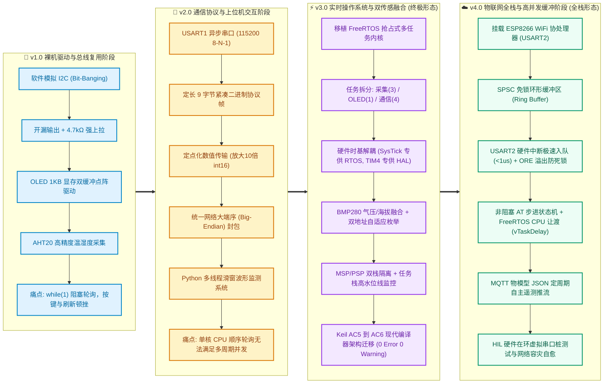

# 🌐 环境监测系统全栈演进全景路线与架构总览 (v1.0 ~ v4.0 全景演进版)

> [!IMPORTANT] 💡 **写在前面：关于本专题**
> 本专栏完整记录了一套基于 **STM32F103** 的智能环境监测终端，如何从**裸机 I2C 轮询驱动**，经历**二进制协议与上位机交互重构**，最终蜕变为**具备抢占式多任务内核、双传感器融合、硬件时基解耦与双栈保护机制**的高性能工业级嵌入式终端系统。
> 整个项目按照研发与求职深度划分为四个递进演化阶段（v1.0 裸机总线 $\to$ v2.0 协议交互 $\to$ v3.0 RTOS 多任务融合 $\to$ v4.0 物联网全栈与高并发缓冲【全栈形态】）。

---

## 🗺️ 全栈演进全景路线图 (v1.0 ~ v4.0)

---

## 📊 三大版本核心指标与技术跨度对比

| 维度 | **v1.0 裸机总线阶段** | **v2.0 协议交互阶段** | **v3.0 RTOS 多任务融合阶段** | **v4.0 物联网全栈与高并发缓冲阶段 (全栈形态)** |
| :--- | :--- | :--- | :--- | :--- |
| **系统核心架构** | 单循环阻塞轮询（Polling） | 顺序封包 + 异步串口输出 | FreeRTOS 抢占式多任务（3大任务） | **FreeRTOS 抢占式多任务（4大并发任务: 采集/显示/通信/IoT）** |
| **外设与总线** | 软件模拟 I2C（PB8/PB9） | 模拟 I2C + USART1（PA9/PA10） | 双 I2C 外设 + 通用定时器 TIM4 + USART1 | **双 I2C + USART1(上位机) + USART2(ESP8266/HIL) + TIM4** |
| **传感器融合** | AHT20 单温湿度 | AHT20 单温湿度 | **AHT20（温湿度） + BMP280（大气压强 + 国际气象海拔换算）** |
| **时钟与时基** | SysTick 单独供 HAL_Delay 死等 | SysTick 单独供 HAL_Delay 死等 | **时基彻底解耦：SysTick 专供 RTOS 心跳，TIM4 独家服务 HAL 时基** |
| **通信机制** | 内部点阵数据总线 | 定长 9 字节二进制协议帧 | 内核消息队列安全共享 | **SPSC 免锁环形缓冲区 + 非阻塞 AT 步进状态机 + MQTT 物模型** |
| **显示与诊断** | OLED 1KB 双缓冲点阵 | Python 多线程动态示波器 | OLED 四行动态刷新与总线诊断 | **OLED 双模监视器 (实时温湿度 + 动态网络状态 AT/WIFI/MQTT/ONLINE)** |
| **内存与安全** | 单一主栈 MSP 运行 | 单一主栈 MSP 运行 | **MSP（中断）+ PSP（任务）双栈隔离防火墙 + 高水位线探测防爆栈** |
| **容错与自愈** | 9 脉冲 I2C 总线死锁解脱 | 帧头+累加和校验过滤误码 | BMP280 双地址自适应枚举 | **串口 ORE 硬件防锁死 + 5秒网络看门狗超时回退自愈机制** |
| **编译器支持** | Keil AC5 (armcc) | Keil AC5 (armcc) | **完成向 ARMCLANG (AC6) 现代编译器架构迁移，纯净代码标准** |

---

## 📁 专栏子文档快速跳转

每一章均包含**“核心设计目标 $\to$ 架构机理深度剖析 $\to$ 关键代码实现 $\to$ 现场硬件排障实录 $\to$ 面试高频考点”**五位一体的内容：

1. [[01_v1.0_裸机驱动与总线复用实录|📄 01 · v1.0 裸机驱动与总线复用实录]]  
   *重点：软件 I2C 物理时序、开漏输出与 4.7kΩ 强上拉、OLED 显存双缓冲映射、从机锁死 SDA 9 脉冲自愈算法。*
2. [[02_v2.0_通信协议与上位机交互实录|📄 02 · v2.0 通信协议与上位机交互实录]]  
   *重点：115200 8-N-1 微秒时延、9 字节二进制帧、数值定点化、大端序网络传输、Python 多线程滑窗抗丢包。*
3. [[03_v3.0_实时操作系统与多传感器融合实录|📄 03 · v3.0 实时操作系统与多传感器融合实录]]  
   *重点：FreeRTOS 上下文切换物理机理、MSP/PSP 双栈保护、PendSV 本质、TIM4 时基解耦、BMP280 双地址自适应、AC6 编译器适配。*

4. [[04_v4.0_物联网全栈与高并发缓冲实录|📄 04 · v4.0 物联网全栈与高并发缓冲实录]]  
   *重点：ESP8266 WiFi 驱动引擎、SPSC 免锁环形缓冲区、中断高速入队与 ORE 排障、非阻塞步进状态机、MQTT 物模型推流、HIL 虚拟串口桩。*