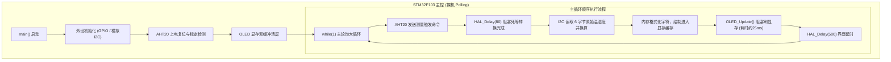

# 🌱 01 · v1.0 裸机驱动与总线复用实录

> **所属专栏**：[[00_系统演进全景路线与架构总览]]  
> **核心阶段**：v1.0 裸机驱动、总线复用与单点传感器显示

---

## 1. 设计目标与裸机轮询架构

在项目的最初形态中，我们的目标是实现一套能够独立工作的环境温湿度采集仪：
- **主控芯片**：STM32F103C8T6（ARM Cortex-M3，72MHz，20KB SRAM，64KB Flash）；
- **外设组成**：AHT20 高精度温湿度传感器 + 0.96 寸 SSD1306 OLED 显示屏；
- **通信拓扑**：两者共用一组单片机通用 GPIO（PB8 作为 SCL，PB9 作为 SDA），通过软件模拟 I2C 协议进行挂载与复用。



---

## 2. 软件模拟 I2C 物理时序（Bit-Banging）

### 2.1 为什么坚决选用软件模拟，不用 STM32 硬件 I2C 外设？
1. **规避芯片硬件硅缺陷（Silicon Errata）**：早期的 STM32F103 硬件 I2C 控制器存在著名的硬件状态机缺陷。在遇到总线噪声干扰或时钟抖动时，硬件极易意外锁死在 `BUSY` 标志位，且无法通过软件标志位清零自愈，必须重启整个外设或下电复位芯片；
2. **极强的可移植性与引脚解耦**：软件模拟代码仅依赖 GPIO 引脚翻转与微秒级延时，未来平滑移植到 GD32、ESP32 或 8 位单片机时，只需替换 GPIO 读写宏，上层业务代码 100% 复用。

---

### 2.2 微观原子时序（5 大基本动作）

```text
SCL:  ──┐      ┌──┐      ┌──┐      ┌──┐      ┌──┐      ┌──
        └──────┘  └──────┘  └──────┘  └──────┘  └──────┘  
SDA:  ──┐   ┌─────┬──┐   ┌──┐   ┌─────────────────────────
        └───┴─────┴──┴───┘  └───┴─────────────────────────
        ↑         ↑              ↑                   ↑
      Start     Bit 1          Bit 2                Stop
```

1. **总线空闲（Idle）**：SCL = 1，SDA = 1（外部上拉电阻维持双高电平）；
2. **起始条件（Start）**：**SCL 保持高电平期间，SDA 产生下降沿（$1 \to 0$）**；
3. **停止条件（Stop）**：**SCL 保持高电平期间，SDA 产生上升沿（$0 \to 1$）**；
4. **数据有效性规则（Data Validity）**：
   - **SCL = 0 时**：允许改变 SDA 上的高低电平（发送方准备数据位）；
   - **SCL = 1 时**：SDA **必须保持稳定不变**（接收方的采样窗口）；
5. **应答槽位（ACK / NACK）—— 第 9 个时钟脉冲**：
   - 发送方输出完 8 位数据后，在第 9 个时钟周期**释放 SDA（让其被上拉抬高）**；
   - 接收方若成功接收，必须将 SDA **强行拉低（ACK = 0）**；
   - 接收方若不拉低（保持高电平），则为 **NACK = 1**。

---

## 3. 开漏输出（Open-Drain）与 4.7kΩ 强上拉选型

### 3.1 为什么必须配置为开漏输出？推挽输出（Push-Pull）为何会烧板？
- **推挽输出的短路灾难**：推挽模式下，引脚内部有 P-MOS 和 N-MOS 互补对称。若设备 A 输出高电平（P-MOS 导通直连 VDD，强灌电流），而从机 B 回应 ACK 输出低电平（N-MOS 导通直连 GND，强拉地），**电源 VDD 与地 GND 会在总线上形成 0 欧姆短路回路**，瞬态电流可达数百毫安，瞬间击穿两端芯片的 GPIO！
- **开漏的“线与（Wired-AND）”机制**：
  - 开漏引脚内部**只有下管 N-MOS**，只能输出低电平（导通接地）或高阻态（截止悬空）；
  - 只有当总线上所有设备都处于高阻态（写 1）时，外部上拉电阻才能把线缆抬高到 3.3V；只要任意一个芯片拉低，总线电平瞬间跌落为 0V；
  - 这种天然的硬件保护，从物理原理上彻底消灭了短路损坏。

### 3.2 为什么上拉电阻精准选型为 4.7kΩ？
- **若电阻过大（如 100kΩ）**：物理线路上存在寄生电容 $C$（引脚电容 + 走线电容约 10~50pF）。信号上升沿依靠上拉电阻充电，充电常数 $\tau = R \times C$。电阻过大导致**信号上升沿变得极其平缓缓慢**。在 100kHz 通信下，采样窗口到来时电压还没充过高电平逻辑阈值（$V_{IH} = 0.7 \times V_{DD} \approx 2.31\text{V}$），导致全线误码；
- **若电阻过小（如 100Ω）**：当芯片内部 N-MOS 导通拉低时，流经引脚的灌电流 $I = \frac{V_{DD}}{R} = \frac{3.3}{100} = 33\text{mA}$，超过了 STM32 单引脚容许的最大极限电流（25mA），引脚发烫，且导通内阻分压导致低电平抬高（高于 $V_{IL} \approx 0.8\text{V}$），从机无法识别 0；
- **工程最佳折中**：标准速率（100kHz）通常选取 **4.7kΩ ~ 10kΩ**。

---

## 4. OLED SSD1306 显存双缓冲与点阵映射原理

### 4.1 显存容量计算
- 物理点阵：$128 \times 64 = 8192$ 个像素点；
- SSD1306 控制器采用**页寻址（Page Addressing）**，纵向每 8 个垂直像素点压缩为一个字节（1 Byte = 8 bits）。垂直 64 个点被切分为 8 页（Page 0~7）；
- 单片机内开辟显存缓冲区数组：
  ```c
  uint8_t OLED_Buffer[8][128]; // 总大小 = 8 * 128 = 1024 字节 (1 KB SRAM)
  ```

### 4.2 像素点亮核心数学映射
要在屏幕的绝对物理坐标 $(x, y)$ 处点亮一个点（$0 \le x \le 127, 0 \le y \le 63$）：
- **页编号（行索引）**：`page = y / 8`（或 `y >> 3`）；
- **字节内的位偏移**：`bit_offset = y % 8`（或 `y & 0x07`）；
- **列索引**：`col = x`；
- **C 语言核心语句**：
  ```c
  OLED_Buffer[y / 8][x] |= (1 << (y % 8)); // 置位目标 bit
  ```

### 4.3 双缓冲（Framebuffer）的设计价值
- 如果每次画点、画线都通过 I2C 向屏幕发指令，总线开销极大，屏幕会出现肉眼可见的“扫描刷新线”和画面撕裂；
- 双缓冲机制让所有 UI 绘制在单片机内部 SRAM 极速运算完成，最后通过一次连续的 `OLED_Update()` 突发数据流刷入屏幕，彻底消除了闪烁。

---

## 5. 现场硬件排障实录（高分面试亮点）

### 踩坑 1：双模块并联 I2C 总线电平跌落至 1.8V
- **现象**：面包板插上 AHT20 和 OLED 时，单独插一个都能读，两个同时插上则全部死锁无法识别。
- **排查**：万用表与示波器测量空闲状态下的 SCL/SDA，发现电压仅有 1.8V 左右，未达到 3.3V 逻辑阈值。剖析发现两个从机模块板载自带的上拉网络阻值设计混乱，并联后等效阻抗异常，弱驱动下无法抬升电平。
- **解决**：在面包板总线上直接外挂两颗 **4.7kΩ 金属膜电阻** 强制上拉至稳固的 3.3V 供电轨，波形上升沿瞬间变得陡峭干净，双外设并联完美打通。

### 踩坑 2：I2C 从机拉死 SDA 导致总线物理级死锁（9 脉冲自愈算法）
- **根因**：单片机在读取从机数据途中发生调试断点或异常复位，从机内部移位寄存器刚好在向总线吐一个 `0`（从机 N-MOS 导通拉低 SDA）。单片机重启后想发 Start 信号，但由于 SDA 已是 0 无法造出下降沿，总线彻底锁死；
- **工业级自愈代码实现**：
  ```c
  void I2C_Bus_Recover(void) {
      // 1. 临时将 SCL 配置为开漏输出，SDA 配置为输入检测
      GPIO_InitTypeDef GPIO_InitStruct = {0};
      GPIO_InitStruct.Pin = GPIO_PIN_8; // SCL
      GPIO_InitStruct.Mode = GPIO_MODE_OUTPUT_OD;
      HAL_GPIO_Init(GPIOB, &GPIO_InitStruct);
      
      GPIO_InitStruct.Pin = GPIO_PIN_9; // SDA
      GPIO_InitStruct.Mode = GPIO_MODE_INPUT;
      HAL_GPIO_Init(GPIOB, &GPIO_InitStruct);

      // 2. 检查 SDA 是否被拉死在低电平
      if (HAL_GPIO_ReadPin(GPIOB, GPIO_PIN_9) == GPIO_PIN_RESET) {
          // 3. 手动翻转 SCL 最多 9 次，逼迫从机移出剩余 bit 并释放 SDA
          for (uint8_t i = 0; i < 9; i++) {
              HAL_GPIO_WritePin(GPIOB, GPIO_PIN_8, GPIO_PIN_RESET);
              Delay_us(5);
              HAL_GPIO_WritePin(GPIOB, GPIO_PIN_8, GPIO_PIN_SET);
              Delay_us(5);
              if (HAL_GPIO_ReadPin(GPIOB, GPIO_PIN_9) == GPIO_PIN_SET) {
                  break; // 从机释放 SDA，提前退出
              }
          }
          // 4. 补发一个标准的 Stop 信号，强行复位从机状态机
          I2C_Stop();
      }
  }
  ```

---

## 6. v1.0 架构瓶颈与演进驱动力

1. **CPU 算力严重浪费**：AHT20 触发后需要等待 80ms，`HAL_Delay(80)` 让 CPU 在空循环中白白消耗几百万个时钟周期；
2. **事件响应严重滞后**：主循环跑一圈耗时超过 100ms（80ms 等待 + 25ms 刷屏），用户按下 30ms 的轻触按键极易被漏检（丢按键）；
3. **数据无法导出分析**：数据仅存在于本地小屏幕上，无法导出到电脑绘制连续历史曲线，促使系统演进至 [[02_v2.0_通信协议与上位机交互实录|v2.0 通信协议阶段]]。
