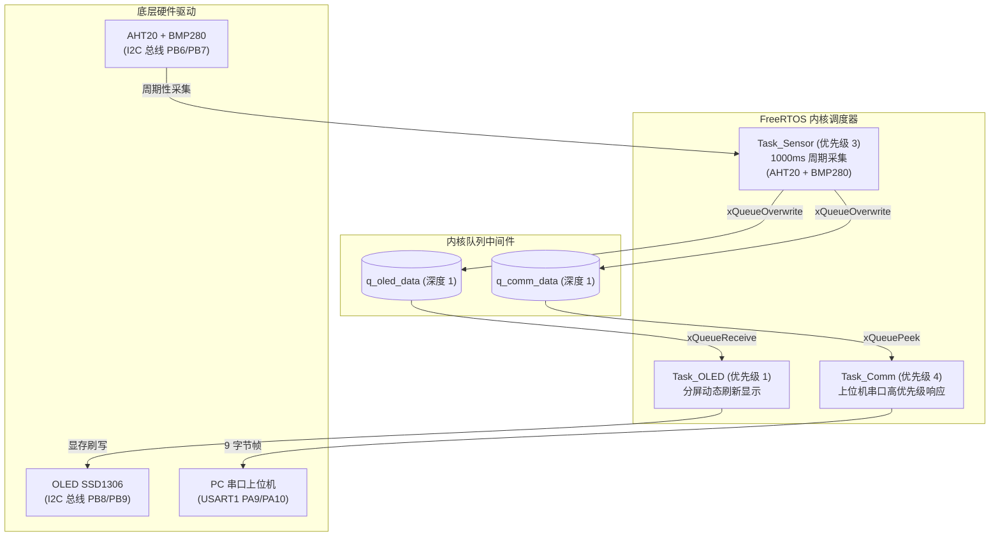

# ⚡ 03 · v3.0 实时操作系统与多传感器融合实录

> **所属专栏**：[[00_系统演进全景路线与架构总览]]  
> **核心阶段**：v3.0 FreeRTOS 抢占式多任务内核移植、硬件时基解耦与 BMP280 气压海拔融合

---

## 1. 设计目标与多任务解耦架构

进入 v3.0 阶段，系统引入了第二颗物理传感器——**BMP280 大气压强与海拔高度传感器**。此时裸机架构已无法支撑“传感器周期采集、OLED 动态刷屏与串口高速响应”的并发要求。
- **内核选型**：移植 **FreeRTOS v10.3** 抢占式实时操作系统；
- **并发任务划分**：
  - `Task_Sensor`（优先级 3）：每 1000ms 周期采集 AHT20 与 BMP280，作为数据生产者；
  - `Task_OLED`（优先级 1）：每 200~500ms 周期刷新 4 行环境数据与系统自诊断信息；
  - `Task_Comm`（优先级 4）：每 1000ms 优先将数据打包为 9 字节协议帧发送给 PC 示波器；
- **任务间通信**：通过 FreeRTOS 队列（`q_oled_data`、`q_comm_data`）进行数据隔离传递。



---

## 2. FreeRTOS 内核调度与上下文切换物理机理

### 2.1 任务调度的本质是什么？
在单核 Cortex-M3 上，宏观上的“同时并发”在微观物理层依然是**基于优先级的快速时分复用抢占执行**。
其物理本质就是 **CPU 上下文切换（Context Switch）**：
1. 将当前即将被挂起的任务的 CPU 寄存器组（`R0~R12`, `SP`, `LR`, `PC`, `xPSR`）保存进该任务的私有栈（PSP）；
2. 调度器从就绪列表中选出最高优先级的任务；
3. 将新任务私有栈中保存的寄存器数值弹出恢复至 CPU 物理寄存器；
4. 更新栈指针，PC 指针跳转到新任务的代码行继续执行。

---

### 2.2 MSP 与 PSP 双堆栈指针的“系统防火墙”机制
ARM Cortex-M 硬件设计了两个物理堆栈指针，共用 `R13` 寄存器编号：
- **MSP（Main Stack Pointer，主栈指针）**：操作系统启动前，以及**所有中断服务函数（ISR）执行时强制使用**；
- **PSP（Process Stack Pointer，进程栈指针）**：**执行普通用户任务代码时使用**。每个任务拥有独立的私有栈空间；
- **安全隔离价值**：
  若某个用户任务发生局部数组越界或函数嵌套过深导致**栈溢出（Stack Overflow）**，破坏的仅仅是该任务自己的 PSP 私有内存；一旦外部硬件中断到来，ARM 硬件自动强制将栈指针切换回 **MSP**，中断服务程序在干净的主栈中平稳执行，**绝不会因为用户任务的栈崩溃而导致系统级中断瞬间瘫痪**。

---

### 2.3 什么是 PendSV？为什么优先级设为最低却能抢占普通任务？
- **为什么需要 PendSV**：
  PendSV（可挂起系统服务调用）是 ARM 专门为 OS 任务切换量身定做的异常。如果直接在 SysTick 滴答定时器中断里硬切任务，恰好碰上紧急的高优先级硬件中断（如串口接收或电机急停），会强行打断甚至延迟破坏硬件中断现场。因此将 PendSV 配置为**系统最低硬件优先级（Priority 15）**。SysTick 仅负责向 NVIC 登记‘挂起 PendSV 请求’，CPU 会等所有正在执行的高优先级硬件中断彻底退出后，才进入 `PendSV_Handler` 执行换人动作，确保外设中断绝不延迟；
- **为什么它能抢占普通任务（核心考点）**：
  - “PendSV 优先级最低”仅仅是在**中断世界内部**比不过其他外部中断；
  - 但在 ARM 硬件层级中，**任何中断（哪怕是 Priority 15 的最低级中断），地位都绝对碾压任何普通用户任务（Thread Mode）**！
  - 当 SysTick 判定需要换人并唤醒 PendSV 时，中断退出瞬间硬件发现 PendSV 排队，CPU 会立刻进入 `PendSV_Handler` 强行剥夺当前运行任务的 CPU 权限，实现李代桃僵。

---

## 3. 时基解耦机制：SysTick 与 TIM4 的硬件冲突

### 3.1 冲突成因与死锁灾难
- STM32 HAL 库的大量通信驱动（如 `HAL_UART_Transmit`）依赖 `HAL_GetTick()` 计算超时；
- FreeRTOS 内核的调度节拍也依赖定时器提供 1ms 时钟；
- 若两者共用 SysTick：FreeRTOS 规范要求将 SysTick 配为系统最低优先级（Priority 15）。若此时在一个优先级为 5 的中断或进入临界区（关中断）时调用了带有超时的 HAL 函数，由于当前优先级高于 SysTick，**SysTick 中断被彻底屏蔽挂起，Tick 计数器永远停滞不走，HAL 函数超时判断永远无法满足，单片机当场死锁挂死！**

### 3.2 规范解耦方案
在 STM32CubeMX 中，将 **HAL 库的时基源（Timebase Source）切换为通用定时器 TIM4**，并将其 NVIC 中断优先级设为最高（Priority 0）；而将 **SysTick 独家专供 FreeRTOS 调度器使用**。即使 SysTick 被降级或屏蔽，TIM4 依然能准时产生 1ms 中断维护 `uwTick`，彻底根除死锁隐患。

---

## 4. 绝对周期延时与任务栈高水位线

### 4.1 为什么必须使用 `vTaskDelayUntil`？
- **`HAL_Delay()` 属于死等犯罪**：纯 CPU 忙等待死循环，延时期间霸占 CPU，低优先级任务被活活饿死；
- **`vTaskDelay()` 是相对延时**：延时基准是调用它的瞬间。若任务自身执行耗时 30ms，调用 `vTaskDelay(1000)`，实际唤醒周期是 $1030\text{ms}$。长期运行**采集周期持续漂移累加（Time Drift）**；
- **`vTaskDelayUntil(&xLastWakeTime, 1000)` 是绝对周期延时**：传入上次唤醒绝对时间戳，自动扣除任务自身运行耗时和被高优先级抢占打断的时间，严格保证每隔 1000ms 恒定唤醒。

### 4.2 任务栈深度单位与高水位线探测（High Water Mark）
- **单位换算**：在 Cortex-M 上，FreeRTOS 栈深度单位是 **Word（字，4 字节）**。传入 256 代表分配 **$256 \times 4 = 1024 \text{ 字节（1KB）}$**；
- **量杯沙子原理**：FreeRTOS 初始化栈时会全盘写入魔术字 `0xA5`。API `uxTaskGetStackHighWaterMark(TaskHandle)` 会在运行时从栈底扫描统计**从未被碰过的剩余字数**。
  - 若返回值接近 0，说明历史极端情况下差点写爆栈（触发 HardFault），必须调大；
  - 若返回值很大，说明分配浪费，可以缩减节约 SRAM。

---

## 5. BMP280 大气压强与高精度海拔测算

### 5.1 国际气象海拔物理公式
BMP280 内部包含 24 位高分辨率压强 ADC 与专用出厂校准寄存器（`dig_T1~T3`, `dig_P1~P9`）。采集到绝对气压值 $P$（Pa）后，通过气象标准公式测算海拔高度：
$$Altitude = 44330.0 \times \left(1.0 - \left(\frac{P}{P_0}\right)^{\frac{1}{5.255}}\right)$$
其中标准海平面气压 $P_0 = 101325 \ \text{Pa}$（$1013.25 \ \text{hPa}$）。

### 5.2 双物理地址（0x76 / 0x77）开机自适应探测枚举
- **物理成因**：BMP280 芯片外部 SDO 引脚接地（GND）时，7 位 I2C 地址为 **`0x76`**；接电源（VDD）时，地址为 **`0x77`**；
- **开机盲测探测代码**：
  ```c
  uint8_t bmp280_real_addr = 0;

  void BMP280_Auto_Detect(void) {
      // 1. 尝试探测 0x76
      if (I2C_Probe(0x76) == ACK) {
          bmp280_real_addr = 0x76;
          return;
      }
      // 2. 若无应答，尝试探测 0x77
      if (I2C_Probe(0x77) == ACK) {
          bmp280_real_addr = 0x77;
          return;
      }
      // 3. 两者均无，报错处理
  }
  ```
- **工程价值**：规避不同模组厂商对 SDO 引脚上下拉不统一的硬件批次坑，固件具备百分之百兼容性。

---

## 6. 现场硬件排障实录（高频面试亮点）

### 踩坑 1：Keil AC5 编译器升级 ARMCLANG (AC6) 报错几百条
- **根因**：旧版 AC5 (armcc) 支持很多非标专有语法（如 `__forceinline`、专用内嵌汇编宏）；新版 AC6 基于纯正现代 Clang/LLVM 内核，无法识别 AC5 专有的旧汇编；
- **解决**：在 MDK 工程中将 FreeRTOS 的移植层文件从 `portable/RVDS/ARM_CM3` 规范替换为官方针对 Clang 适配的 `portable/GCC/ARM_CM3`，并在包含路径中精准更新，直接 **0 Error 0 Warning** 通过。

---

## 7. v3.0 阶段工程成果与核心交付总结

至此，系统完成了向**工业级多任务嵌入式终端**的全面蜕变与完美收官：
1. **三大并发任务解耦闭环**：通过 FreeRTOS 抢占式调度器，`Task_Sensor`（1000ms 精准采集）、`Task_OLED`（200ms 屏幕刷新）、`Task_Comm`（1000ms 上位机优先通信）各司其职，利用非阻塞延时让渡 CPU，彻底消灭了裸机时代的卡顿与丢按键缺陷；
2. **底层硬件级可靠性保障**：SysTick 与 TIM4 硬件时基彻底解耦杜绝超时死锁，MSP 与 PSP 双堆栈机制筑起内核级内存防火墙，结合 BMP280 物理双地址（0x76/0x77）开机自适应盲测探测，系统具备极高的工业级抗干扰与自愈能力；
3. **现代工程标准交付**：全面完成了从旧版 AC5 到现代 ARMCLANG (AC6) 编译器的架构迁移，达成 0 Error 0 Warning 纯净编译，项目成为兼具底层时序、通信协议、操作系统内核与传感器融合的极高含金量嵌入式求职代表作！
