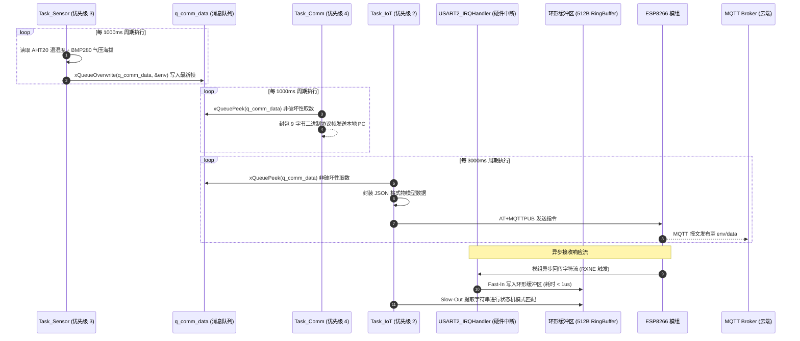

# ☁️ 04 · v4.0 物联网全栈与高并发缓冲实录

> **所属专栏**：[[00_系统演进全景路线与架构总览]]  
> **核心阶段**：v4.0 IoT 物联网全栈终极版 (ESP8266 驱动引擎、SPSC 环形缓冲、MQTT 物模型与网络容灾)

---

## 1. 设计目标与系统全景拓扑

在 v4.0 阶段，系统完成了向**工业级物联网边缘计算终端**的终极蜕变：
- **无线协处理器**：挂载 ESP8266 Wi-Fi 模组，通过第二串口（USART2）进行全双工 AT 交互；
- **核心业务使命**：将 AHT20 和 BMP280 融合的环境全量数据，封装为标准化 JSON 物模型报文，以 MQTT 协议推送到云端 Broker（如阿里云、EMQX 公共服务器）；
- **全系统 4 大并发任务最终定型**：
  1. `Task_Sensor`（优先级 3）：1000ms 周期采集双传感器（数据生产者）；
  2. `Task_OLED`（优先级 1）：200ms 独立刷新屏幕 UI 与网络自诊断；
  3. `Task_Comm`（优先级 4）：1000ms 优先向 PC 上位机发送 9 字节二进制帧；
  4. `Task_IoT`（优先级 2）：3000ms 周期非破坏性获取数据并上报云端。



---

## 2. 异步中断环形缓冲区（Ring Buffer）：Fast-In Slow-Out 法则

### 2.1 为什么坚决杜绝阻塞式 AT 交互？
许多初学者教程在单片机发送 AT 命令后，直接使用 `HAL_UART_Receive(..., 1000)` 死等响应。在多任务系统中：
- 阻塞等待让 CPU 陷入空转，高优先级的环境采集和屏幕刷新被活活卡死；
- 若网络握手产生数十毫秒的抖动，极易误判为“超时断开”，甚至漏收异步到来的 MQTT 数据包。

---

### 2.2 环形缓冲区结构与 SPSC 免锁安全证明
在 `Core/Src/esp8266.c` 中定义：
```c
#define ESP8266_RX_BUF_SIZE 512

static volatile uint8_t  s_rx_buf[ESP8266_RX_BUF_SIZE];
static volatile uint16_t s_rx_head = 0; // 写指针
static volatile uint16_t s_rx_tail = 0; // 读指针
```

#### 为什么无需互斥锁（Mutex）即可保证绝对安全？
1. **单生产者单消费者（SPSC）模型**：
   - 中断服务函数是**唯一的生产者**：它只负责写入数据并单向推进 `s_rx_head`，绝不修改 `s_rx_tail`；
   - 物联网任务是**唯一的消费者**：它只负责读取数据并单向推进 `s_rx_tail`，绝不修改 `s_rx_head`；
2. **硬件指令级原子性**：
   - 在 32 位 ARM Cortex-M 架构下，针对 16 位整型指针变量的赋值是一条汇编指令完成的，天生具备原子性；
3. **`volatile` 内存可见性**：
   - 强制编译器每次读写直接操作物理内存，严禁将其缓存在通用寄存器中，消除了跨执行流数据不同步的隐患。

---

### 2.3 判空、判满与静默防溢出策略
- **判空条件**：`s_rx_head == s_rx_tail`；
- **判满条件**：`(s_rx_head + 1) % ESP8266_RX_BUF_SIZE == s_rx_tail`（预留 1 个空位用于区分空和满）；
- **中断快进入队实现（Fast-In）**：
  ```c
  void ESP8266_RxCallback(uint8_t data) {
      uint16_t next_head = (s_rx_head + 1) % ESP8266_RX_BUF_SIZE;
      if (next_head != s_rx_tail) {
          s_rx_buf[s_rx_head] = data;
          s_rx_head = next_head;
      }
      // 若满载，静默丢弃最新字节，绝不破坏环状拓扑与相邻内存
  }
  ```

---

### 2.4 串口 ORE 硬件错误捕获与自动清除
在 `Core/Src/stm32f1xx_it.c` 中：
```c
void USART2_IRQHandler(void) {
    // 1. 正常接收中断处理
    if (__HAL_UART_GET_FLAG(&huart2, UART_FLAG_RXNE) != RESET) {
        uint8_t ch = (uint8_t)(huart2.Instance->DR & 0xFF);
        ESP8266_RxCallback(ch);
    }
    // 2. 关键防死锁: 检查并清除 Overrun 溢出错误标志
    if (__HAL_UART_GET_FLAG(&huart2, UART_FLAG_ORE) != RESET) {
        __HAL_UART_CLEAR_OREFLAG(&huart2); // 彻底消除硬件死锁
    }
}
```
> **💡 为什么要特别处理 ORE？**  
> 当突发大数据涌入导致数据寄存器未及时读出时，硬件置位 `ORE`。**若不主动清除，STM32 硬件会自动永久关闭后续所有接收中断！** 代码加入此防御后，串口硬件具备了 100% 自动解脱能力。

---

## 3. 非阻塞 AT 状态机引擎与回显抑制

### 3.1 `ESP8266_SendCmd` 状态机与 CPU 让渡
```c
ESP8266_Status_t ESP8266_SendCmd(const char *cmd, const char *expect_res, uint32_t timeout_ms) {
    char temp_buf[ESP8266_RX_BUF_SIZE];
    uint32_t elapsed = 0;
    const uint32_t step_ms = 20;

    ESP8266_ClearRx(); // 清空旧数据

    // 发送指令
    HAL_UART_Transmit(&huart2, (uint8_t *)cmd, strlen(cmd), 1000);
    HAL_UART_Transmit(&huart2, (uint8_t *)"\r\n", 2, 1000);

    // 步进轮询环形缓冲区
    while (elapsed < timeout_ms) {
        vTaskDelay(pdMS_TO_TICKS(step_ms)); // 关键：休眠20ms出让CPU！
        elapsed += step_ms;

        get_rx_string(temp_buf, sizeof(temp_buf));

        // 匹配成功关键词
        if (expect_res != NULL && strstr(temp_buf, expect_res) != NULL) return ESP8266_OK;
        // 捕获异常
        if (strstr(temp_buf, "ALREADY CONNECTED") != NULL) return ESP8266_ALREADY_CONNECTED;
        if (strstr(temp_buf, "ERROR") != NULL) return ESP8266_ERROR;
        if (strstr(temp_buf, "FAIL") != NULL) return ESP8266_FAIL;
    }
    return ESP8266_TIMEOUT;
}
```
**用意**：轮询中调用 `vTaskDelay`，将 CPU 算力完整释放给采集任务和刷新任务，彻底消灭了死等。

### 3.2 为什么必须关闭本地回显（`ATE0`）？
- ESP8266 默认开启回显（`ATE1`），发 `AT+CWJAP?`，模块会先原样回传 `AT+CWJAP?` 再发 `OK`；
- 单片机环形缓冲区塞满了自己刚才发出去的指令字符，状态机检索时容易产生误判匹配；
- 模块初始化第一步强制下发 **`ATE0`** 命令，彻底杜绝回显干扰。

---

## 4. 多消费者队列无损共享机制（`xQueuePeek`）

### 4.1 破坏性读取（Receive）与非破坏性查看（Peek）对比
- **`xQueueReceive()`（破坏性读取）**：
  从队列读取数据，**并立即将其从队列中彻底删除销毁**。若有两个任务读同一个队列，会形成“竞争抢食”，一方读走另一方必然扑空饿死；
- **`xQueuePeek()`（非破坏性查看）**：
  只拷贝队列头部数据副本，**保留原数据在队列中不动**。

### 4.2 本项目落地方案
- **生产者（`Task_Sensor`）**：每 1000ms 通过 `xQueueOverwrite(q_comm_data, &sensor_env)` 将最新的环境数据覆盖写入深度为 1 的队列槽位中；
- **本地串口任务（`Task_Comm` 1000ms）**：调用 `xQueuePeek(q_comm_data, ...)` 拿数据发往 PC；
- **物联网任务（`Task_IoT` 3000ms）**：同样调用 `xQueuePeek(q_comm_data, ...)` 拿数据发往云端；
- **架构成效**：两套异步周期的通信链路完美共享同一份物理采样，杜绝了多任务数据互斥死锁。

---

## 5. MQTT 物模型上云与双引号转义处理

### 5.1 JSON 物模型报文规范
按照阿里云/EMQX 通用物模型标准，封装紧凑的 JSON 格式：
```json
{"temp":25.4,"humi":60.5,"press":1013.2,"alt":12.5}
```

### 5.2 AT 命令行双引号转义技术
乐鑫 AT 发布语法为：`AT+MQTTPUB=0,"<topic>","<data>",0,0`。
- 参数 `<data>` 已经被双引号包裹；
- 若内部的 JSON 也包含原始双引号（如 `"temp"`），ESP8266 的词法解析器会误将第一个双引号当成参数结束，截断数据并报语法错误；
- **驱动自动转义实现**：
  ```c
  // 遍历 JSON 字符串，遇 " 则替换为 \"
  for (uint16_t i = 0; json_payload[i] != '\0'; i++) {
      if (json_payload[i] == '"') {
          escaped_json[j++] = '\\';
      }
      escaped_json[j++] = json_payload[i];
  }
  ```
  最终向模块发出的命令为：
  `AT+MQTTPUB=0,"env/data","{\"temp\":25.4,\"humi\":60.5,\"press\":1013.2,\"alt\":12.5}",0,0`

### 5.3 为什么选用 QoS 0？
- **QoS 0（最多交付一次 - At most once）**：发后即忘，最轻量，无确认包重传；
- 环境时序数据具有连续性（每 3 秒刷新一次）。偶发丢失历史单点无实质影响，最新一帧立刻会补上。选用 QoS 0 最大限度节省了单片机内存和模组通信延迟。

---

## 6. 网络容灾心法：指数退避重连算法（Exponential Backoff）

### 6.1 现实困境
网络掉线或弱网时，若以固定短周期（如每 100ms）疯狂发送连接指令，会导致：
1. ESP8266 协议栈处理拥堵，甚至发热崩溃；
2. 无线信道被雪崩式重试包挤满，加剧断网。

### 6.2 算法实现机制
- 设定初始退避时间 $1\text{s}$，最大退避上限 $30\text{s}$；
- 失败时将延时翻倍：$1\text{s} \to 2\text{s} \to 4\text{s} \to 8\text{s} \to 16\text{s} \to 30\text{s}$；
- 期间调用 `vTaskDelay` 让出 CPU，不影响其他业务任务；
- **一旦连接成功，立刻将退避时间复位回初始 $1\text{s}$**！

---

## 7. 现场硬件排障实录（面试杀手锏）

### 踩坑 1：ESP8266 射频瞬态电流拉跌电源引发 Brown-out Reset
- **现象**：单机跑传感器极其稳定，但只要一发送 `AT+CWJAP` 连接 Wi-Fi，板子就必定莫名其妙复位重启。
- **排查**：示波器抓取 3.3V 供电轨，发现连接瞬间射频功率放大器（PA）全开，工作电流突发飙升至近 300mA，电源轨跌落出一个深达 **接近 1V** 的负脉冲低谷，击穿欠压保护门限触发硬件复位。
- **解决之道**：
  1. 切断单片机小功率板载 LDO 向 Wi-Fi 取电的路径，改为外部独立稳压供电，并与 STM32 严格短接共地；
  2. 在 ESP8266 的 VCC 与 GND 引脚最靠近端，并联焊接一颗 **220μF 低 ESR 固态电容** 吸收瞬态电流，电源毛刺被压制在 80mV 以内，自此彻底消除复位死锁。

### 踩坑 2：FreeRTOS 堆大小调优（从 4KB 扩大到 8KB）
- **现象**：移植完 v4.0 代码后，前三个任务正常，`Task_IoT` 无论如何都不启动。
- **排查**：查看 FreeRTOS 堆剩余空间。F103 原有 `configTOTAL_HEAP_SIZE` 设为 4KB。前三个任务加上内核队列已耗费 3.1KB。第四个任务因有 JSON 格式化分配了 256 Words（1024 字节）栈，导致 `xTaskCreate` 因内存不足静默失败。
- **解决**：在 `FreeRTOSConfig.h` 中将堆调增至 **8KB**，问题瞬间迎刃而解，且 SRAM 仍保留 11KB+ 充足安全裕量。

---

## 8. 端云验证闭环

配套编写了轻量级 Python 异步监听脚本 `verify_mqtt_sub.py`，订阅公共 Broker（`broker.emqx.io:1883`）的主题 `env/data`：
```text
============================================================
  STM32 智能环境监测终端 v4.0 - MQTT 遥测订阅验证终端
============================================================
[2026-10-21 09:30:15] 收到主题 [env/data] 的遥测报文:
  原始报文: {"temp":25.4,"humi":60.5,"press":1013.2,"alt":12.5}
  ┌─────────────────── 物模型环境解析数据 ───────────────────┐
  │  ├─ 环境温度 (Temperature) :   25.4 ℃                       │
  │  ├─ 相对湿度 (Humidity)    :   60.5 %RH                     │
  │  ├─ 大气压强 (Pressure)    : 1013.2 hPa                    │
  │  └─ 估算海拔 (Altitude)    :   12.5 m                      │
  └───────────────────────────────────────────────────────────┘
```
至此，整个系统达成了从底层物理电气特性、时序驱动、多任务并发调度到云端物联网数据流转的**百分之百全栈闭环**！
