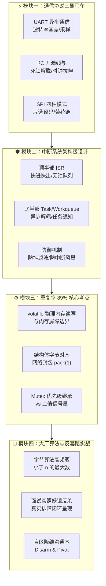
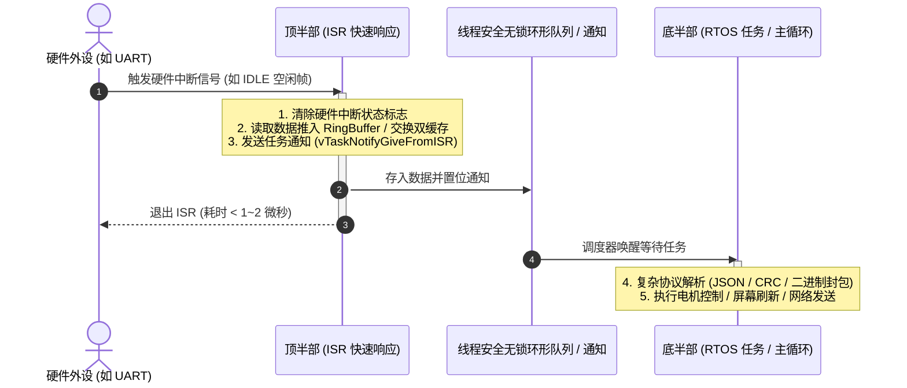

# 🔥 大厂嵌入式高频面试真题与核心考点破局 QA (全网爆款面经精粹)

> [!IMPORTANT] 💡 **写在前面：从“背八股”到“大厂降维破局”**
> 近期技术社区（小红书、牛客网、大厂求职圈）热度最高的几篇爆款面经反复印证了一个事实：
> **“嵌入式面试真没有那么难，重复率高达 89%，但为什么大量人还是被挂？”**
> 
> 原因就在于：**面试官已经听腻了死记硬背的名词解释，现在的大厂面试正在全面转向“底层机理 + 架构设计 + 现场排障闭环 + 反撒谎深挖”。**
> 本文针对全网爆款面试热点进行全景复盘与深潜拓展，为你提供**可以直接在面试中降维打击竞争对手的满分回答框架**。

---

## 🧭 知识导航图谱



---

## 🔗 关联笔记联动
- 📱 本项目演进问答与速成实战宝典：[[嵌入式实习面试通关与速成指南]]
- 🧱 底层单片机外设原理：[[STM32核心知识体系]]

---

# 🚀 模块一 · SPI、I²C、UART 三驾马车大厂标准满分回答框架

> 📌 **对应爆款**：《大厂面试都爱问的 SPI、I²C、UART 到底怎么答？》

### Q1: 面试官让你“对比一下 UART、I²C 和 SPI”，如何做到条理清晰且体现工程深度？
> [!NOTE] **满分应答矩阵（第一步给出全景表格，第二步提炼核心差异）**

| 核心维度 | UART（通用异步收发器） | I²C（集成电路总线） | SPI（串行外设接口） |
| :--- | :--- | :--- | :--- |
| **同步 / 异步** | **异步**（无同步时钟线） | **同步**（共用 SCL 时钟线） | **同步**（共用 SCK 时钟线） |
| **双工机制** | **全双工**（独立 TX/RX） | **半双工**（共用单根 SDA） | **全双工**（独立 MOSI/MISO） |
| **引脚开销** | 2 根（TX, RX，可外加流控 CTS/RTS） | **固定 2 根**（SCL, SDA） | **$3 + N$ 根**（SCK, MOSI, MISO + $N$ 个 CS） |
| **拓扑结构** | 点对点（1 对 1） | **多主多从**（依靠 7/10 位物理地址） | **一主多从**（片选引脚硬选择） |
| **传输速率** | 较低（常用 9600~921600 bps） | 低/中速（标准 100kbps、快速 400kbps、高速 3.4Mbps） | **极高**（几十 MHz，甚至上百 MHz） |
| **硬件协议开销** | 起始位、数据位、校验位、停止位（开销约 20%） | 起始/停止位、地址帧、ACK/NACK 应答位（开销较高） | **极小**（纯移位寄存器交换，无协议包头开销） |
| **物理驱动形态** | 通常推挽输出（标准 CMOS/TTL 电平） | **开漏输出（Open-Drain）+ 外部上拉电阻** | 通常推挽输出（高速驱动能力强） |

> [!TIP] **升华一句话总结（给面试官留下深刻架构印象）**：
> “在实际工程中，三者各司其职：**UART 赢在简单独立，适合调试与长距离解耦通信；I²C 赢在极度节省引脚，适合挂载多个低速传感器；SPI 赢在极致传输吞吐量，是高速彩屏和存储芯片的不二之选。**”

---

### Q2: 深入剖析：UART 为什么允许波特率误差？最大允许误差是多少？
> [!IMPORTANT] **答题底层机理**
> 1. **为什么允许有误差？**  
>    UART 是异步通信，收发双方没有共用的时钟线，只能依靠各自内部的波特率发生器对时间进行离散采样。UART 接收端采用**过采样机制**（通常为 16 倍波特率时钟）：当检测到起始位的下降沿时，接收端启动计数，在第 8、9、10 个过采样时钟点对数据中心进行采样（3 取 2 滤波），确认起始位有效，随后每隔 16 个采样时钟（即 1 个位宽时间）采样一位数据。
> 2. **允许的最大累积误差是多少？**  
>    一帧标准 UART 数据由：**1 位起始位 + 8 位数据位 + 1 位停止位** 构成，总共 10 个周期。
>    在停止位采样的最后时刻，累积的时钟相位漂移**绝对不能超过半个位周期（$\pm 0.5 \text{ bit}$）**，否则采样点就会跨入相邻位的区域导致乱码。  
>    $$\text{最大理论容差} = \frac{0.5 \text{ bit}}{10 \text{ bit}} = \pm 5\%$$
>    考虑到硬件上升沿延迟、信号占空比失真和噪声抖动，**工业界公认的安全波特率误差必须在 $\pm 2.5\%$ 甚至 $\pm 2.0\%$ 以内**。这也是为什么高波特率通信必须使用高精度外部晶振（HSE），而不能使用温漂严重的芯片内部 RC 振荡器（HSI）。

---

### Q3: 为什么 I²C 必须配置为“开漏（Open-Drain）+ 外部上拉电阻”？什么是“时钟拉伸（Clock Stretching）”？
> [!IMPORTANT] **答题话术（电气本质 + 协议机制）**
> 1. **开漏 + 上拉的核心原因**：
>    - **防止推挽短路（总线冲突）**：I²C 支持多设备共用一条数据线。如果使用推挽输出，当从机 A 想要输出高电平（连 VCC），而从机 B 想要输出低电平（连 GND）时，VCC 与 GND 将直接短路，瞬间烧毁芯片引脚。开漏输出只具备“拉低”能力，无法主动输出高电平，高电平全靠外部上拉电阻提供。
>    - **天然实现“线与（Wired-AND）”逻辑**：总线上只要有任意一个设备输出低电平，整条总线即为低电平；只有所有设备都释放总线（呈现高阻态）时，总线才被电阻拉高。这为 **多主设备仲裁（Arbitration）** 和 **ACK 握手** 提供了物理硬件基础。
> 2. **什么是时钟拉伸（Clock Stretching）？**
>    - 当主机以较快的速度向从机发送请求（如读取温度传感器），从机如果还没准备好数据（例如 ADC 转换未完成），或者从机内部正在处理高优先级中断，从机可以**主动将 SCL 时钟线强制拉低并保持**。
>    - 主机检测到 SCL 迟迟没有被上拉电阻拉高，就知道从机正在忙碌，于是暂停发送下一个时钟周期，直到从机释放 SCL 恢复高电平，通信才继续。这是 I²C 协议在硬件层面实现的纯天然“流量控制（Flow Control）”。

---

### Q4: I²C 总线死锁（SDA 一直被拉低）的根本原因是什么？工程上如何自愈恢复？
> [!NOTE] **现场排障高分回答（结合项目实战经历）**
> 1. **死锁根因**：
>    在通信过程中（主机正在读从机数据），MCU 突然复位（如看门狗复位、调试器断点复位、瞬态掉电），而此时从机刚好在向 SDA 输出低电平数据（例如数据位为 0 或正在发送 ACK）。MCU 复位后重新启动，I²C 控制器重新初始化，但从机毫不知情，依然在静静等待下一个 SCL 时钟脉冲来把这一位传输完成，因此从机死死拉住 SDA 不放。此时主机会认为总线被持续占用（`BUSY` 标志置位），整个 I²C 系统彻底瘫痪。
> 2. **工程自愈解决方案（9 个脉冲恢复法）**：
>    在单片机启动并初始化硬件 I²C 外设之前，先执行一段软件防死锁检测逻辑：
>    - 将 SCL 和 SDA 临时配置为普通 GPIO；
>    - 检测 SDA 引脚：如果 SDA 为低电平，说明从机卡死在输出状态；
>    - **由主控向 SCL 引脚手动翻转输出 9 个时钟脉冲（Clock Toggling）**：从机每接收到一个时钟，内部移位寄存器就步进一次，最多经过 8 个数据位 + 1 个 NACK/ACK，从机就会释放对 SDA 的占用；
>    - 随后主机向总线发送一个合法的 **STOP 条件**，将从机状态机彻底重置回空闲状态；
>    - 此时释放引脚，重新把引脚交还给 I²C 外设或软件模拟 I²C。

---

### Q5: SPI 协议如果挂载的从机太多，片选引脚不够用，该如何扩展？
> [!NOTE] **两种经典工程方案**
> 1. **方案一：外挂译码器（Decoders，如 74HC138）**
>    - 使用 MCU 的 3 个 GPIO 连接 3-8 译码器的输入端，即可通过片选译码扩展出 8 个独立的片选引脚，极大地节省了 MCU 的 GPIO 资源。
> 2. **方案二：菊花链拓扑（Daisy Chain）**
>    - **连接方式**：所有从机共用同一个 SCK 和同一个 CS 片选信号。主机的 MOSI 连接到第一个从机的 DIN，第一个从机的 DOUT 连接到第二个从机的 DIN，依次串联，最后一个从机的 DOUT 接回主机的 MISO。
>    - **工作机制**：所有从机内部形成一个超长的大移位寄存器。主机拉低 CS 后，一次性连续发送 $N \times 8$ 位数据，数据像流水一样穿过所有从机，最后拉高 CS，所有从机在同一时钟沿将数据锁存生效。常用于多级 LED 驱动芯片（如 MAX7219）或多路工业 ADC。

---

# 🛡️ 模块二 · 嵌入式中断如何设计？（系统级架构演进）

> 📌 **对应爆款**：《面个工程师，问嵌入式中断如何设计，他愣了》

### Q6: 面试官问：“在你的嵌入式架构设计中，中断服务函数（ISR）是如何规划的？”
> [!IMPORTANT] **回答总纲：快进快出（Fast In, Fast Out）与分层解耦**
> 一个合格的资深嵌入式工程师，中断设计绝对不是在 `IRQHandler` 里面写几百行业务逻辑，而是必须遵循 **“顶半部（Top Half）+ 底半部（Bottom Half）”** 的经典异步处理架构。



---

### Q7: 为什么绝对不能在中断（ISR）中执行耗时操作、延迟函数或动态内存分配？
> [!IMPORTANT] **答题切入点：CPU 状态机与实时性崩塌**
> 1. **破坏整个系统的硬实时性（Real-Time Collapse）**：
>    当 CPU 处于某个 ISR 执行状态时，相同优先级及更低优先级的中断会被硬件屏蔽（NVIC 无法响应）。如果 ISR 里写了 `HAL_Delay(10)`，在这 10 毫秒内，所有关键控制（如电机换相定时器、编码器测速脉冲、急停检测）全部无法响应，极易造成硬件失控损坏。
> 2. **引发死锁崩溃（Deadlock）**：
>    - `HAL_Delay()` 底层依赖 SysTick 滴答定时器中断累加 `uwTick`。如果 SysTick 的抢占优先级小于或等于当前外部中断的优先级，在 ISR 中调用 `HAL_Delay()`，SysTick 永远无法打断当前 ISR，`uwTick` 永远不自增，程序陷入**永久死循环死锁**！
>    - 动态内存分配函数（如 `malloc`、`free`、`pvPortMalloc`）通常包含全局互斥锁或临界区保护，且执行时间具有不可预测性（Non-deterministic）。在 ISR 中调用可能因等待锁或堆碎片合并而触发 HardFault 异常。
> 3. **不可睡眠（Non-sleepable）**：
>    中断上下文没有独立的任务控制块（TCB），它借用的是系统的中断堆栈（MSP）。ISR 无法被操作系统调度器挂起，因此任何带超时阻塞的 API（如 `xQueueReceive` 等待超过 0 ticks）在 ISR 中一律被禁止。

---

### Q8: 什么是“中断风暴（Interrupt Storm）”？工程中如何防御？
> [!NOTE] **高级排障与防御机制**
> - **成因**：由于外部硬件线路虚焊、按键/接触器强烈的物理机械抖动、工控环境中的强电磁干扰，导致 GPIO 或外设引脚在极短时间内产生几十万次翻转；或者外设状态寄存器的错误标志（如串口 `ORE` 溢出错误、`FE` 帧错误）在 ISR 中没有被正确清除，导致 CPU 一退出中断立刻又被同个中断拉回，CPU 占用率达到 100%，主任务彻底“饿死”。
> - **防御策略**：
>   1. **标志位即时清除**：进入 ISR 第一步确保严格按照数据手册的时序清除挂起标志（Clear Pending Bit）；
>   2. **限频与退避（Rate Limiting）**：对于 GPIO 外部中断，一律在硬件端加上 RC 低通滤波电路（如 10kΩ 电阻 + 100nF 电容）；软件上禁止使用边沿中断作为原始按键信号，改为在 10ms 定时器中断中采用**软件状态机采样连续稳定电平**；
>   3. **熔断切断机制（Circuit Breaker）**：如果检测到单位时间（如 100ms）内某中断触发次数超过阈值（如 > 1000 次），在 ISR 中直接关闭该外设的中断使能寄存器（Disable IRQ），打上异常报警标记，转由底半部低频轮询或故障保护程序接管。

---

### Q9: 请给出一个串口接收数据不丢包、CPU 占用极低的最优中断实战设计方案。
> [!TIP] **杀手级应回应答：串口 DMA + 空闲中断（IDLE）+ 双缓冲区（Ping-Pong Buffer）**
> “在处理高波特率（如 921600 bps 或高频传感器连续吐数据包）串口通信时，如果每个字节产生一次中断，CPU 会频繁触发压栈出栈而过载瘫痪。我的中断设计是：
> 1. **硬件零介入搬运**：开启串口的 **DMA 循环接收模式**，所有数据直接由 DMA 控制器从外设数据寄存器搬运到 SRAM 内存数组，不消耗哪怕一个 CPU 指令周期；
> 2. **帧边界触发**：仅开启串口的 **IDLE（总线空闲中断）**。当外部数据包发送完毕，总线出现一个字节以上的空闲静默期时，硬件自动触发一次空闲中断；
> 3. **极简 ISR 顶半部**：在 IDLE 中断中，读取 DMA 计数器计算接收到的实际字节数，然后将数据指针推入处理队列，并迅速切换到备用的第二块缓冲区（双缓冲机制），耗时不到 1 微秒；
> 4. **底半部异步解析**：RTOS 协议解析任务被通知唤醒，从容解析完整数据帧，彻底做到**零丢包、低延时、极低 CPU 负载**。”

---

# ⚙️ 模块三 · 嵌入式面试重复率 89% 的底层考点全解

> 📌 **对应爆款**：《嵌入式工程师，面试就问这些，重复率 89％》 & 《嵌入式面试，真没有那么难，反反复复就这些》

### Q10: `volatile` 的底层本质到底是什么？它能保证多线程原子性吗？能代替内存屏障吗？
> [!IMPORTANT] **大厂深挖痛点：不要只背“防止编译器优化”！**
> 1. **底层物理本质**：
>    现代编译器为了提高运行效率，会尽可能将经常使用的变量加载到 CPU 的内部寄存器（如 ARM 的 R0~R12）中缓存起来，之后的计算直接从寄存器读取，而不会重复通过物理总线去访问慢速的 SRAM。
>    `volatile`（易变的）告诉编译器：**“这个变量的物理内存地址随时可能被外部硬件电路或异步中断更改，请禁止对其进行寄存器缓存优化；对该变量的每一次读取和写入，必须实打实发射一条总线访存指令（如 ARM 汇编中的 `LDR` 和 `STR`），直接操作实际物理内存内存条/SRAM！”**
> 2. **三大典型应用场景**：
>    - 访问硬件外设内存映射寄存器（如 `*(volatile uint32_t *)0x4001080C`）；
>    - 中断服务函数（ISR）与主任务之间共享的标志位或缓冲区索引；
>    - 多任务操作系统中任务之间未加锁共享的全局变量。
> 3. **边界警惕（连环追问陷阱）**：
>    - ❌ **`volatile` 绝不保证原子性**：一个 `volatile int a; a++;` 操作在 ARM 汇编下依然会被拆解为三条独立指令：`LDR r0, [a]` $\to$ `ADD r0, r0, #1` $\to$ `STR r0, [a]`。在多任务或中断并发下，依然会发生竞态条件数据错乱！
>    - ❌ **`volatile` 不能代替内存屏障（Memory Barrier）**：`volatile` 只能约束单线程内的编译器指令优化，无法阻止现代乱序执行处理器（Out-of-Order Execution CPU）在硬件流水线层面的指令重排。防止多核多线程乱序必须使用显式内存屏障（如 `__DMB()`、`__DSB()`）。

---

### Q11: 结构体内存对齐原则是什么？网络通信或驱动通信时如何处理？
> [!NOTE] **底层原因 + 对齐公式 + 工业级解决方案**
> 1. **为什么需要内存对齐？**
>    32 位 CPU 的数据总线宽度是 32 位（4 字节）。CPU 每次从内存读取数据都是以 4 字节为边界进行对齐寻址的。
>    - 如果一个 4 字节的 `uint32_t` 变量存放在 `0x20000000`（4 的倍数），CPU 仅需 **1 次总线访问周期** 就能读出；
>    - 如果存放在 `0x20000001`（未对齐），CPU 必须发起 **2 次总线周期** 读取相邻的两个 4 字节字，然后再进行移位拼接，性能骤降 50% 以上；在某些严格对齐的架构（如 Cortex-M0 或特定 ARM 配置）下，跨边界访存会直接触发硬件 HardFault 崩溃！
> 2. **对齐计算两大定律**：
>    - **成员对齐**：每个结构体成员的相对起始偏移量，必须是该成员类型自身大小的整数倍；不够的地方自动填充无效的空闲字节（Padding）。
>    - **整体对齐**：结构体的总有效字节大小，必须是结构体内**最大基本类型成员大小的整数倍**。
> 3. **面试实战演算题**：
>    ```c
>    struct MyData {
>        uint8_t  a; // 占用 1 字节；后填充 3 字节 padding (为了对齐 b 的 4 字节边界)
>        uint32_t b; // 占用 4 字节；偏移量为 4
>        uint16_t c; // 占用 2 字节；偏移量为 8
>    };              // 当前占用 10 字节；但最大成员为 4 字节，整体必须对齐为 4 的倍数
>                    // 最终结构体大小 sizeof(struct MyData) = 12 字节！
>    ```
> 4. **网络通信与通信总线（UART/CAN/I2C/SPI）解决方案**：
>    在协议封包时，严禁让编译器自动填充 padding，否则收发两端若编译器对齐策略不一致会导致协议字段完全错位。必须使用伪指令强制 1 字节紧凑对齐：
>    ```c
>    #pragma pack(push, 1) // 开启 1 字节对齐
>    typedef struct {
>        uint8_t  header;
>        uint32_t timestamp;
>        uint16_t checksum;
>    } __attribute__((packed)) Packet_t; // 大小严格为 1 + 4 + 2 = 7 字节
>    #pragma pack(pop)     // 恢复原有对齐
>    ```

---

### Q12: 为什么二值信号量（Binary Semaphore）不能用来保护共享资源？它与互斥量（Mutex）有什么本质区别？
> [!IMPORTANT] **死磕痛点：优先级反转（Priority Inversion）**
> 很多初学者认为“二值信号量取值只有 0 和 1，互斥量也是 0 和 1，所以它们可以互相替换”，这是严重的面试扣分项！

```mermaid
sequenceDiagram
    autonumber
    participant HighTask as 高优先级任务 (High)
    participant MidTask as 中优先级任务 (Medium)
    participant LowTask as 低优先级任务 (Low)
    participant Res as 共享资源 (互斥锁 Mutex)

    LowTask->>Res: 1. 占有共享资源 (Take Mutex)
    activate LowTask
    HighTask->>Res: 2. 抢占执行，尝试获取资源 (阻塞等待)
    deactivate HighTask
    Note over LowTask,HighTask: 此时发生优先级反转风险！
    Note over Res: 互斥锁触发【优先级继承机制】！<br/>将 LowTask 优先级临时提升至 HighTask 等级
    MidTask--xLowTask: 3. 中任务试图抢占，但无法打断被提速后的 LowTask！
    LowTask->>Res: 4. 低任务快速释放资源 (Give Mutex)
    Note over Res: LowTask 恢复原有低优先级
    deactivate LowTask
    Res->>HighTask: 5. 高优先级任务立刻获得资源运行
    activate HighTask
```

> [!TIP] **回答要点总结**：
> 1. **核心定位不同**：
>    - **互斥量（Mutex）** 的设计初衷是**资源保护（Mutual Exclusion）**，它强调“谁持有谁释放（Ownership）”；
>    - **二值信号量（Semaphore）** 的设计初衷是**事件同步（Synchronization）**，强调“一个任务触发，另一个任务响应”，甚至允许任务 A 产生信号，由任务 B 或 ISR 去消费释放。
> 2. **致命差异：优先级继承（Priority Inheritance）**：
>    - 如果用二值信号量保护资源，当低优先级任务持有资源时，高优先级任务被阻塞挂起。此时若有一个完全无关的中优先级任务就绪，中优先级任务会抢占低优先级任务运行，导致低优先级任务迟迟无法释放资源，最终导致**最高优先级的任务被中等优先级的任务无限期延迟，这就是经典的“优先级反转”灾难**（1997 年火星探路者号死机正是由此引起）。
>    - **互斥量具备优先级继承机制**：当高优先级任务在等待互斥量时，系统会自动将持有该互斥量的低优先级任务临时提速到高优先级同级，防止中途被中等优先级任务打断，促使其快速释放资源，然后恢复其原有低优先级，从而彻底规避优先级反转问题。

---

### Q13: 单片机上电复位后，系统从 0 地址到进入 `main()` 函数经历了什么？
> [!NOTE] **嵌入式启动全链路（系统启动黑盒解密）**
> 1. **硬件读取初始指针**：
>    - CPU 上电复位瞬间，硬件强制将 PC 指针指向固件起始地址 `0x08000000`（内部 Flash 首地址，映射为 `0x00000000`）；
>    - 硬件从 `0x00000000` 读取第 1 个 32 位双字，自动加载并赋值给 **主堆栈指针（MSP）**；
>    - 硬件从 `0x00000004` 读取第 2 个 32 位双字，这就是 **复位向量地址（Reset_Handler）**，加载给程序计数器 **PC**；
> 2. **执行启动文件（`startup_stm32xxx.s` 汇编）**：
>    - 跳转执行 `Reset_Handler`；
>    - 调用 `SystemInit()`：配置外部高速晶振（HSE）、设置 PLL 锁相环倍频器，将系统主频提升到标称频率（如 72MHz）；
> 3. **初始化 C 语言运行环境（C Run-Time Environment Setup）**：
>    - **搬运 `.data` 段**：将编译保存在 Flash 中的有初值全局变量和静态变量的初始值，完整拷贝到 SRAM 内存空间；
>    - **清零 `.bss` 段**：将所有未初始化或初始化为 0 的全局变量在 SRAM 中全部刷成 0；
>    - 初始化堆和栈空间（Heap & Stack）；
> 4. **跳入高级语言入口**：
>    - 执行跳转指令 `bl __main`（或 `bl main`），正式进入开发者熟悉的 C 语言 `main()` 函数。

---

# 🎯 模块四 · 字节跳动大厂规律与算法边界破局

> 📌 **对应爆款**：《字节 北京 嵌入式面经 坏了 真被总结出规律了》

### Q14: 字节跳动等一线大厂在考察嵌入式时，有什么深挖规律？
> [!IMPORTANT] **大厂面试的三大隐形标准**
> 1. **从“名词解释”到“汇编指令与总线动作”**：
>    - 问 `a++`：不仅看语法，还要看是不是原子操作，追问汇编层面 `LDREX/STREX` 独占访问机制；
>    - 问 `const`：追问 `const` 修饰的全局变量到底存放在内存的哪个段？（存放在 `.rodata` 只读数据段，物理上固化在 Flash 中，不占 SRAM 内存）；
>    - 问 `&arr + 1` 与 `arr + 1` 的区别：`arr` 是数组首元素地址（步长为元素大小），`&arr` 是整个数组的指针（步长为整个数组总字节数）。
> 2. **从“功能列表”到“全链路排障闭环”**：
>    - 拒绝只说“我跑通了 I2C / CAN 驱动”；
>    - 大厂必追问：**“有没有遇到过总线仲裁丢失？波形毛刺有多宽？上拉电阻阻值怎么计算选型的？系统极限压力下 CPU 占用率最高飙到多少？栈溢出怎么捕获的？”**
> 3. **必考底层数据结构与算法边界**：
>    - 几乎所有大厂嵌入式岗都必须现场手写 1~2 道算法题。考察最多的并非天花板级的图论，而是**位运算、环形缓冲区、链表操作，以及结合贪心与二分的“边界逼近题”**。

---

### Q15: 大厂高频算法原题解析：给定数字集合 $A$ 和目标数 $n$，求由 $A$ 中数字组成的小于 $n$ 的最大数
> [!NOTE] **高频面试真题情境**
> - **输入**：$n = 23121$，数组 $A = [2, 4, 9]$
> - **输出**：$22999$
> - **考察核心**：**贪心策略 + 逐位字典序匹配 + 回溯退位**。

#### 💡 算法核心解题思路：
1. **转字符串从高到低处理**：将数字 $n$ 转为字符串形式，方便逐位遍历。先将数组 $A$ 从小到大排序。
2. **贪心逐位逼近**：
   - 对于 $n$ 的第 $i$ 位数字：
     - 若 $A$ 中存在**等于**当前位的数字，优先尝试暂定该数字，继续深入递归下一位；
     - 若 $A$ 中存在**小于**当前位的最大数字，则当前位直接选用该数字，此后的**所有低位无脑全部填充 $A$ 中的最大值**，直接得到最优解！
3. **回溯处理（边界核心）**：
   - 如果走到某一位时，连 $A$ 中的最小值都比当前位的数字大，说明高位“贪心借位”失败，必须触发**回溯（Backtrack）**：
   - 退回上一位，把上一位替换为比它原本选择更小的下一个可用数字；如果上一位能替换成功，其后所有低位无脑填 $A$ 的最大值；
   - **最高位退位特殊边界**：如果连最高位都无法选出合法数字（例如 $n = 21121, A = [3, 4, 9]$），说明构造出的结果位数必须比 $n$ 少一位（即 4 位数），直接全部填满 $A$ 中的最大值，结果为 $9999$。

```c
// 标准 C 语言核心解法逻辑
#include <stdio.h>
#include <string.h>
#include <stdlib.h>

int find_max_less(int *A, int a_size, int target_digit) {
    int candidate = -1;
    for (int i = 0; i < a_size; i++) {
        if (A[i] < target_digit) {
            if (candidate == -1 || A[i] > candidate) candidate = A[i];
        }
    }
    return candidate; // 找不到返回 -1
}

int has_equal(int *A, int a_size, int target_digit) {
    for (int i = 0; i < a_size; i++) {
        if (A[i] == target_digit) return 1;
    }
    return 0;
}
```

---

# 🕵️‍♂️ 模块五 · 面试官“防画饼照妖镜”与现场反杀策略

> 📌 **对应爆款**：《面了几天嵌入式，会撒谎的真不少啊》 & 《不开玩笑，姐的嵌入式面试已经到了秒懂地步》

### Q16: 面试官是如何在 3 分钟内识破一个“注水简历 / 撒谎候选人”的？
> [!WARNING] **面试官眼中典型的“造假/画饼特征”**
> 1. **满口“精通底层驱动”，一问寄存器时序全卡壳**：
>    问：*“你说你手写了 SPI 驱动，那 CPOL=0, CPHA=1 时，数据是在第几个时钟沿被采样的？”* 假经验者瞬间慌乱，真实调试过的人脱口而出：“偶数沿（第二个沿）”。
> 2. **参数张口就来，追问来源露馅**：
>    问：*“你 FreeRTOS 任务栈大小分了 256 字节，为什么分 256？有没有测过水线高低？”* 假经验者回答：“教程上写的/默认的”；真工程师回答：“通过 `uxTaskGetStackHighWaterMark()` 抓取了极端并发下的历史最小空闲栈空间，实测最大深度 180 字节，保留 30% 冗余设为 256”。
> 3. **只有成功经验，没有“翻车排障”故事**：
>    真实做过硬件项目的工程师，身上全是伤疤（电容虚焊、示波器抓电平跌落、被编译器优化坑）。如果一个人讲项目顺风顺水什么 bug 都没遇到，100% 是只照抄了 Demo。

---

### Q17: 如何真诚应对质疑并实现降维反杀？
> [!TIP] **黄金反杀公式：坦承现代工程方法 + 抛出真实排障物理证据**
> 
> **面试官质疑**：“你这个项目代码是不是从网上抄的 / AI 自动生成的？”
> 
> **满分回答范例**：
> > “面试官您好，我不回避这个问题。在基础驱动样板代码和通用数据结构骨架上，我确实**深度利用了 AI 编码助手和成熟库来提高开发效率**。在当今工业界，高效利用现代化工具本身就是一名工程师的核心素养。
> > 
> > **但我核心的不可替代价值，在于以下三个 AI 摸不到电路板就绝对做不到的现场排障上**：
> > 1. **物理电平跌落排查**：在调试双 I2C 设备并联时，SDA 上升沿由于总线分布电容过大变得极其缓慢，甚至无法达到 0.7 VCC 门限。这是我**用示波器抓波形发现上升沿平缓，手动换上 4.7kΩ 强上拉电阻才解决的**；
> > 2. **总线死锁与9脉冲自愈**：在热插拔调试传感器时，从机在 ACK 阶段将 SDA 拉低后意外复位导致总线永久死锁。这是我**通过逻辑分析仪分析总线状态，在初始化中加入模拟 9 个 SCL 时钟脉冲+发送 Stop 信号才打通的总线自愈机制**；
> > 3. **系统崩溃栈回溯**：面对 HardFault，我能直接**在仿真器里读取 MSP/PSP 指针，定位堆栈中第 7 层的 PC 寄存器地址，在 Disassembly 窗口一秒定位具体哪行代码引发了空指针解引用**。
> > 
> > 这些实物调试的深坑，只有亲手拿烙铁、万用表和逻辑分析仪蹲在实验室一条条抓包验证的人才能真正打通。”

---

### Q18: 被问到完全不会的技术盲区，如何使用“Disarm & Pivot（解除戒备 + 顺势引渡）”技巧绝地拿分？
> [!NOTE] **四步高情商破局公式**
> 1. **第一步：真诚坦承（Disarm）**
>    *“坦白讲，在以往的工程实践中，关于 [XXX 某个特定底层外设/特定协议栈] 的生产级开发，我确实还没有深入接触过……”* （展现自信与真诚，绝不胡编乱造）
> 2. **第二步：逻辑推理（First Principles）**
>    *“……但我根据计算机底层的第一性原理来理解，它需要解决的核心痛点无非是两点：数据的时序可靠同步，以及防止并发访问下的总线冲突。如果让我来主导设计，我会借鉴 I2C 线与仲裁或双缓冲区的思路，分三层来构建……”* （展现即使没做过也有极强的工程推导力）
> 3. **第三步：给出排障闭环方案（Execution Plan）**
>    *“如果我在现场遇到这个未知问题，我会按三步走：查阅芯片勘误手册（Errata）$\to$ 用逻辑分析仪抓取物理时序 $\to$ 最小系统二分法隔离……”*
> 4. **第四步：顺势引渡（Pivot 回自己主场）**
>    *“……虽然这个组件我没调过，但在做 FreeRTOS 结合串口通信时，我也遇到过完全相同的并发时钟解耦难题，当时我是通过定制硬件定时器时基和无锁环形队列彻底打通的，底层逻辑是完全相通的。”*

---

# 📚 核心复盘与求职寄语

大厂面试考察的从来不是**谁背的课本定义更多**，而是**在面临真实硬件缺陷、并发冲突和死机异常时，你有没有清晰的底层思维模型与不慌乱的排障方法论**。

将本篇总结与你的项目实践深度融合，面试时做到**心中有时序、眼里有波形、手上有排障闭环**，大厂 Offer 志在必得！

---
*本文档归档于个人 Obsidian 知识库：`项目与实践/STM32智能环境监测/面试QA/`*
