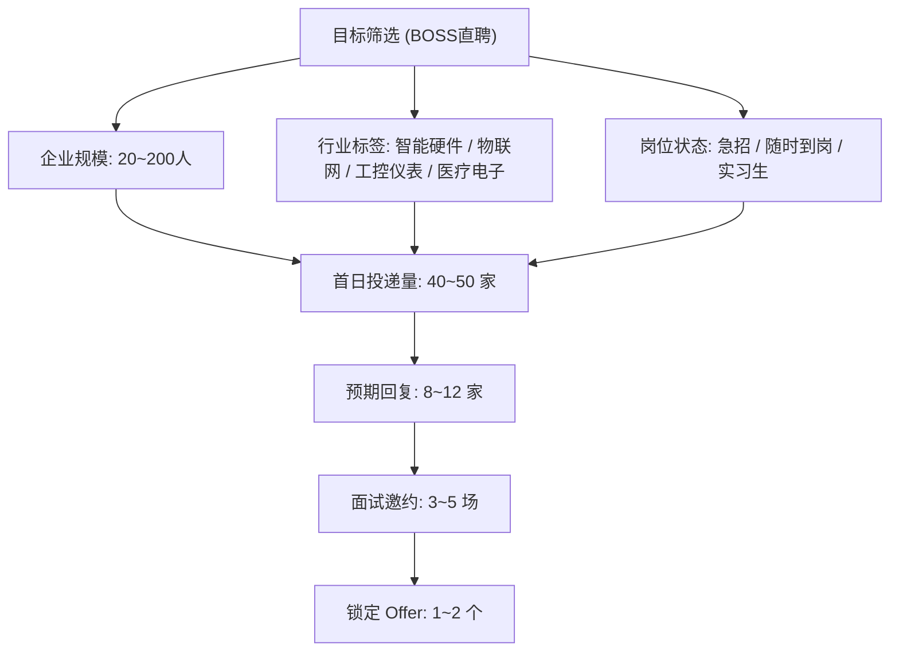

# ⚡ 嵌入式实习与秋招面试通关与速成指南 (v1.0~v3.0 实战精粹问答大全)

> [!IMPORTANT] 💡 **核心定位与应答应战心法（v1.0~v3.0 专属）**
> - **面对面试官的心态**：不要胆怯，也不要死背死板的八股文定义。以**“真正焊过板子、调过时序、抓过波形、排查过死机”**的现场实战工程师姿态作答。
> - **黄金应答公式**：**物理本质 / 硬件原理 $\to$ 为什么这样设计（对比反面案例） $\to$ 结合自己板子的排障踩坑经验**。
> - **应对“人机协同/AI编码”质询的标准黄金口径**：
>   > *“这个项目从 v1.0 裸机轮询、v2.0 二进制协议到 **v3.0 FreeRTOS 抢占式多任务与双传感器融合**，整个系统的架构规划、外设通信拓扑、任务优先级划分、硬件时基解耦与传感器选型全部由我独立规划主导。在驱动模板和通用数据结构的初步生成上，我合理利用了 AI 编码助手大幅提效；*  
>   > *但我最核心的工程价值，在于**底层时序逻辑的严格把控、FreeRTOS 双栈机制（MSP/PSP）安全隔离、SysTick 与 TIM4 硬件时基解耦、BMP280 双地址开机盲测探测**，以及最关键的**硬件现场实物排障（包括 4.7kΩ 上拉电阻阻抗匹配消除电容迟滞、I2C 从机锁死 9 脉冲解脱自愈、Keil AC6 现代编译器架构迁移等）**。这些硬件层面的坑，AI 是摸不到电路板的，全部是我在实验桌上用万用表、示波器和调试器一行行硬件调试打通的。”*

---

## 🗺️ 项目演进全景路线图


---

## 🧭 快速跳转导航目录

- [[#📌 第一篇 · v1.0 裸机驱动与总线时序篇]]
  - [[#1.1 核心知识速成精要]]
  - [[#1.2 高频面试深度 Q&A 题库]]
  - [[#1.3 硬件接线与实战排障实录（面试“吹点”）]]
- [[#📌 第二篇 · v2.0 通信协议与上位机交互篇]]
  - [[#2.1 核心知识速成精要]]
  - [[#2.2 高频面试深度 Q&A 题库]]
  - [[#2.3 硬件接线与实战排障实录（面试“吹点”）]]
- [[#📌 第三篇 · v3.0 实时操作系统与多传感器融合篇 (终极形态)]]
  - [[#3.1 核心知识速成精要]]
  - [[#3.2 高频面试深度 Q&A 题库]]
  - [[#3.3 硬件接线与实战排障实录（面试“吹点”）]]
- [[#📌 第四篇 · 嵌入式通识 C 语言与底层架构八股]]
  - [[#4.1 C 语言三大核心杀手锏]]
  - [[#4.2 Cortex-M 中断体系与调试核心]]
  - [[#4.3 看门狗与系统可靠性防御]]
- [[#📌 第五篇 · 系统级排障、应急思维与面试元技能]]
  - [[#5.1 系统运行卡死与 HardFault 三步定位法]]
  - [[#5.2 被问到完全不会的技术盲区如何高情商化解（Disarm & Pivot）]]
  - [[#5.3 应对“代码是不是 AI 写的”标准反击策略]]
- [[#📌 第六篇 · 7天极速求职特种作战实操清单]]
  - [[#6.1 目标企业与投递漏斗模型]]
  - [[#6.2 BOSS 直聘秒回“杀手锏”打招呼模版]]
  - [[#6.3 7天排期执行备忘录]]

---

# 📌 第一篇 · v1.0 裸机驱动与总线时序篇

### 1.1 核心知识速成精要
1. **裸机轮询架构（Polling Architecture）及其瓶颈**：
   - 核心模式：`main()` 中一个巨大的 `while(1)` 死循环，按顺序依次执行：读温湿度 -> 刷新 OLED -> 延时。
   - **痛点瓶颈**：由于所有外设串行执行，一旦 AHT20 转换需要延时 `HAL_Delay(80)`，整个系统就会彻底卡死，期间无法响应任何外部事件（按键丢触发、屏幕刷新顿挫）。
2. **软件模拟 I2C 物理时序（Bit-Banging）**：
   - **GPIO 配置**：SCL（时钟线）和 SDA（数据线）必须配置为 **开漏输出（Open-Drain）+ 外部上拉电阻**。
   - **起始信号 (Start)**：SCL 为高电平期间，SDA 产生**下降沿**（高 -> 低）。
   - **停止信号 (Stop)**：SCL 为高电平期间，SDA 产生**上升沿**（低 -> 高）。
   - **数据有效性规则**：SCL 为高电平时，SDA 必须保持电平稳定（采样窗口）；只有在 SCL 为低电平时，才允许改变 SDA 的高低状态。
   - **应答机制 (ACK / NACK)**：发送完 8 位数据后的第 9 个时钟周期，主机释放 SDA（拉高），从机若成功接收则将 SDA 拉低（ACK 为 0，NACK 为 1）。
3. **OLED (SSD1306) 显存双缓冲点阵驱动**：
   - 分辨率：128 × 64 像素，共 8 页（Page 0~7），每页包含 128 个字节，总显存容量 = $128 \times 64 \div 8 = 1024 \text{ 字节 (1KB)}$。
   - **双缓冲设计（Framebuffer）**：在单片机内部 SRAM 开辟 `uint8_t OLED_Buffer[8][128]` 数组。所有打点、画线、字符串绘制均在内存数组中极速完成，最后通过一次连续的 `OLED_Update()` 刷入屏幕，彻底消除画面撕裂与闪烁。

---

### 1.2 高频面试深度 Q&A 题库

#### Q1: 为什么在项目中选择软件模拟 I2C（Bit-Banging），而不是 STM32 的硬件 I2C 外设？
> [!NOTE] **答题话术**
> “主要出于两点核心考量：
> 1. **芯片硬件缺陷规避（硅缺陷 Silicon Errata）**：STM32F103 早期的硬件 I2C 外设存在著名的硬件缺陷。在受到外部电磁干扰或特定的时钟抖动时，其内部硬件状态机极易卡死在 `BUSY` 标志位，且无法通过软件标志位清零自愈，必须重启整个外设甚至下电复位芯片；
> 2. **引脚解耦与跨平台移植性**：软件模拟 I2C 可以任意指定普通 GPIO（本项目使用 PB8、PB9）。代码不依赖特定的硬件映射通道，后续移植到 GD32、ESP32 或 8 位低成本 MCU 时，仅需修改微秒延时和引脚高低电平宏定义即可平滑复用。”

#### Q2: 为什么 I2C 总线必须配置为“开漏输出（Open-Drain）+ 外部上拉电阻”？用推挽输出（Push-Pull）不行吗？
> [!IMPORTANT] **答题话术（核心考点）**
> “绝对不能用推挽输出，必须使用开漏输出搭配外部上拉电阻，原因如下：
> 1. **实现‘线与（Wired-AND）’逻辑，防止总线短路烧毁**：I2C 是多机共享总线。若使用推挽输出，当设备 A 发送高电平（内部 P-MOS 导通连 VDD）、设备 B 发送低电平（内部 N-MOS 导通接地）时，电源与地之间直接形成短路回路，巨大的短路电流会瞬间烧毁 GPIO 引脚。而开漏输出仅具备下拉能力，输出 1 时内部断开呈高阻态，只有所有设备都释放总线时，上拉电阻才将总线拉高；任何一个设备拉低，总线即为 0V，从硬件原理上杜绝了短路隐患；
> 2. **实现极简的双向半双工通信（释放总线）**：SDA 是单线双向传输。发送完一个字节后，主机只需输出 1（释放总线），从机即可自由拉低总线回复 ACK。主机完全不需要反复在寄存器中频繁切换输入/输出模式，极大降低了代码时序复杂度；
> 3. **支持多机仲裁与时钟延展（Clock Stretching）**。”

#### Q3: 为什么外部上拉电阻通常选 4.7kΩ？选 100Ω 或 100kΩ 会怎样？结合你的排障经历讲讲。
> [!TIP] **答题话术（展示硬件功底）**
> “这是一个在 **信号边沿陡峭度（RC常数）** 与 **引脚灌电流功耗** 之间的工程权衡：
> 1. **阻值过大（如 100kΩ）**：物理线路上存在寄生电容 $C$（引脚电容 + 走线电容约 10~50pF）。上升沿由上拉电阻向寄生电容充电决定，时间常数 $\tau = R \times C$。电阻过大会导致信号**上升沿极其平缓**，变成圆弧钝波。在 100kHz 通信时，采样窗口到来时电压还没充过高电平逻辑阈值（$V_{IH} = 0.7 \times V_{DD} \approx 2.31\text{V}$），引发严重读写误码；
> 2. **阻值过小（如 100Ω）**：当设备输出 0 拉低总线时，灌入芯片内部 N-MOS 管的电流 $I = \frac{V_{DD}}{R}$ 过大，不仅功耗剧增，还会超过 GPIO 容许的最大极限电流（STM32 单引脚最大 25mA），甚至因为导通内阻分压导致低电平抬高（高于 $V_{IL} \approx 0.8\text{V}$），从机无法识别 0；
> 3. **实物踩坑排障**：在我的 v1.0 项目中，当 AHT20 和 OLED 挂在同一组总线时，万用表测得空闲电平仅有 1.8V 左右，双模块并联全部死机。排查发现是两个模块板载上拉阻值不匹配，我最终在总线上外挂了两颗 **4.7kΩ 金属膜电阻** 强制上拉至 3.3V，确保波形上升沿干净利落，双模块并联自此稳定运行。”

#### Q4: 现场手写代码：你能用 C 语言写出 I2C 的起始条件和停止条件吗？微观时序规则是什么？
> [!NOTE] **答题话术与手写代码**：
> ```c
> // I2C 起始信号：SCL高电平期间，SDA产生下降沿 (高 -> 低)
> void I2C_Start(void) {
>     SDA_HIGH(); 
>     SCL_HIGH();
>     Delay_us(5);
>     SDA_LOW();   // 下降沿产生 Start
>     Delay_us(5);
>     SCL_LOW();   // 钳住SCL低电平，占用总线，准备传输数据
> }
> 
> // I2C 停止信号：SCL高电平期间，SDA产生上升沿 (低 -> 高)
> void I2C_Stop(void) {
>     SDA_LOW(); 
>     SCL_LOW();
>     Delay_us(5);
>     SCL_HIGH();
>     Delay_us(5);
>     SDA_HIGH();  // 上升沿产生 Stop，释放总线回空闲
> }
> ```
> **微观规则要点**：
> - **SCL 为低电平时**：允许改变 SDA 的高低电平（发送方准备数据位）；
> - **SCL 为高电平时**：SDA **必须保持稳定不变**，此时是接收方的**采样窗口**；
> - **重复起始信号 (Restart)**：在总线未发 Stop 停止信号的前提下，直接再次产生一次 Start 时序，用于多主防抢占或在读取从机寄存器时无缝切换传输方向（写寄存器地址 $\to$ 读数据）。

#### Q5: 为什么主机在从机读取多字节数据时，读完最后一个字节必须发送 NACK？
> [!WARNING] **答题话术（杀手级易错考点）**
> “这是为了**防止总线死锁、确保主机能够顺利发出 Stop 停止信号**：
> 1. 如果主机在读完最后一个字节后依然发送 ACK（0），从机内部状态机会误以为主机还要继续读下一个字节，从而在接下来的时钟周期把下一个未知字节的最高位（Bit 7）强行推上 SDA 线；
> 2. 假如这个未知的 Bit 7 恰好是 `0`（低电平），从机的 N-MOS 会牢牢将 SDA 焊死在 0V；
> 3. 此时主机想要结束通信，必须产生 Stop 信号（在 SCL 高电平期间将 SDA 从 0 拉高到 1）。但因为 SDA 被从机短路到地，主机根本拉不高电平，**上升沿无法形成，Stop 信号当场流产，整条总线陷入永久死锁**；
> 4. 因此，主机读完最后一字节必须回 **NACK（保持 SDA 为 1）**，严正告知从机‘我读完了，立即释放 SDA 线’，从机才会断开 MOS 管，主机才能顺利发送 Stop 退出。”

#### Q6: 如果 I2C 从机受到干扰死机把 SDA 永久拉低，导致总线挂死，如何自愈？
> [!IMPORTANT] **答题话术（老工程师标志题）**
> “直接发 Stop 信号是无效的，因为 SDA 已被拉低无法造出上升沿。我的分级自愈方案如下：
> 1. **软件级自愈（标准 9 个 SCL 时钟脉冲解脱法）**：
>    - 暂时脱离 I2C 外设，将 SCL 配置为普通推挽 GPIO 输出，SDA 配置为带上拉的输入模式；
>    - 手动模拟翻转 SCL，连续输出**最多 9 个时钟脉冲**。因为 I2C 一个传输周期是 8 位数据 + 1 位应答，从机每收到一个 SCL 就会向外吐出一位卡在移位寄存器里的数据；
>    - 在第 9 个脉冲周期，从机移完全部数据后会主动释放 SDA（SDA 恢复高电平）；
>    - 主机检测到 SDA 变高后，立即补发一个标准的 **Stop 信号**，强行把从机的状态机复位回 IDLE 状态，随后重新初始化 I2C 外设；
> 2. **硬件级兜底（电源门控 Power Gating）**：
>    - 对于内部逻辑彻底锁死的传感器，在硬件设计时通过单片机 GPIO 控制一颗 **P-MOS 管** 对传感器 VDD 供电。若 9 脉冲自愈失败，直接控制 P-MOS 切断供电 100ms 进行**硬件下电冷重启**，百分之百恢复自愈。”

#### Q7: OLED SSD1306 显存容量如何计算？请写出点亮 (x, y) 坐标的位操作语句。
> [!NOTE] **答题话术**
> 1. **容量计算**：$128 \times 64$ 分辨率共 8192 个点。控制器采用‘页结构（Page）’，纵向每 8 个垂直点压缩为一个字节（1 Byte = 8 bits），垂直 64 点分为 8 页（Page 0~7）。总显存 = $8 \times 128 = 1024 \text{ 字节（1KB）}$；
> 2. **打点位操作语句**：
>    ```c
>    // 将显存中 (x, y) 坐标对应的像素点置 1
>    OLED_Buffer[y / 8][x] |= (1 << (y % 8));
>    ```
> 3. **双缓冲价值**：所有字符、UI 线条绘制全部在内存数组极速完成，最后通过 `OLED_Update()` 一次性刷入屏幕，彻底消除画面撕裂和闪烁。

---

### 1.3 硬件接线与实战排障实录（面试“吹点”）
> [!TIP] 🛠️ **我的实物踩坑实录 1**
> - **现象**：刚插好面包板时，AHT20 和 OLED 只有其中一个能识别，两个插在同一组 I2C 总线（PB8/PB9）上就全部死机。
> - **原因排查**：万用表测量 SCL/SDA 电压，发现仅有 1.8V 左右。因为两个从机模块板载自带的上拉电阻阻值不匹配，并联后等效电阻过小，或者主板供电被拉垮。
> - **最终解决**：在总线上外挂两颗 **4.7kΩ 金属膜电阻** 强制上拉至稳定的 3.3V，确保电平上升沿陡峭干净，双模块并联自此稳定运行。

---

# 📌 第二篇 · v2.0 通信协议与上位机交互篇

### 2.1 核心知识速成精要
1. **UART / USART 异步通信物理帧**：
   - 采用标准参数：`115200 8-N-1`（每秒 115200 波特，8 位数据，无校验，1 位停止位）。
   - 传输一个字节耗费的时间估算：1 个起始位 + 8 个数据位 + 1 个停止位 = 10 位；
     传输 1 字节时间 $\approx \frac{10}{115200} \approx 86.8 \ \mu\text{s}$。
2. **定长 9 字节二进制协议帧设计**：
   - 杜绝低效且易受干扰的纯 ASCII 字符串，设计结构化二进制数据帧：
     - `Byte 0`: 帧头 1（`0xAA`）
     - `Byte 1`: 帧头 2（`0x55`）
     - `Byte 2`: 数据类型（`0x01` 表示环境数据）
     - `Byte 3~4`: 原始温度值（int16，高字节在前，分辨率 0.1℃）
     - `Byte 5~6`: 原始湿度值（uint16，高字节在前，分辨率 0.1%RH）
     - `Byte 7`: 校验和（`Checksum` = Byte2 到 Byte6 的算术累加和取低 8 位）
     - `Byte 8`: 帧尾（`0x0D` / `\r`）
3. **Python 上位机多线程动态波形绘制**：
   - 使用 `PySerial` 负责后台串口监听，`Matplotlib` 负责前端波形双通道实时绘制，利用定长字节对齐机制解析丢帧。

---

### 2.2 高频面试深度 Q&A 题库

#### Q8: 串口传输数据时，为什么杜绝 printf 字符串，专门定制定长 9 字节二进制协议帧？
> [!IMPORTANT] **答题话术**
> “主要有三大工业级工程优势：
> 1. **带宽占用减少近一半**：`printf("T:25.4,H:60.5\r\n")` 占用 16~18 字节；定长二进制帧仅需 9 字节，传输耗时从 1.5ms 压缩至 0.78ms，串口占用率直降 50%；
> 2. **确定性与零解析开销**：ASCII 字符串长度不固定（正负号、小数点位数动态变动），解析需要调用极为笨重耗资源的 `sscanf` 或正则切片，容易引发内存越界；二进制帧长度恒定，上位机通过指针或结构体反序列化在微秒级还原数据；
> 3. **抗干扰与帧对齐**：二进制帧拥有双特征帧头（`0xAA 0x55`）和校验和（Checksum），接收端可通过滑窗状态机精准过滤噪声误码。”

#### Q9: 传输传感器浮点数时，为什么推荐“定点化（Fixed-Point）”，坚决反对直接发 float？
> [!NOTE] **答题话术**
> 1. **节省 50% 传输空间**：`float` 遵循 IEEE-754 标准占用 4 字节；将其放大 10 倍转为 `int16_t`（保留 0.1 精度）仅需 2 字节；
> 2. **杜绝跨平台浮点序列化歧义**：不同架构的 CPU 或上位机在处理 float 浮点数内存映射、非正规数或尾数舍入时可能存在偏差，整型二进制原码/补码在所有平台上定义完全一致；
> 3. **减少 MCU 算力消耗**：低端 Cortex-M3 无硬件浮点运算单元（FPU），软浮点运算库体积大且耗时，整型位移仅需单周期指令。”

#### Q10: 什么是大端模式和小端模式？STM32 是哪种？为什么通信协议必须统一使用大端序？
> [!NOTE] **答题话术**
> - **小端模式（Little-Endian）**：低位字节存放在低地址（‘小端低低’）。**ARM Cortex-M (STM32) 默认是小端模式**；
> - **大端模式（Big-Endian）**：高位字节存放在低地址（符合人类阅读习惯）。**网络通信标准协议（TCP/IP）规定统一采用大端序（网络字节序）**；
> - **协议统一规范**：为了防止小端单片机发给不同上位机时产生字节逆序错乱，协议规定必须按大端序发送：
>   ```c
>   frame[3] = (uint8_t)(temp >> 8);   // 先发高 8 位
>   frame[4] = (uint8_t)(temp & 0xFF);  // 后发低 8 位
>   ```
>   上位机 Python 统一使用 `struct.unpack('>h', data)` 以大端解码，杜绝大小端歧义。”

#### Q11: 在切分 16 位有符号温度变量时，为什么缓冲区数组使用 `uint8_t` 而不是 `int8_t`？
> [!IMPORTANT] **答题话术（触及计算机底层原理）**
> “这是因为：
> 1. **通信缓冲区的本质是‘纯粹的裸字节容器’**：物理总线只有电平，没有正负数。`uint8_t` 在 C 语言中代表 8 个二进制位构成的纯原始数据槽位；
> 2. **负数补码与符号位污染灾难**：比如 $-20.0^\circ\text{C}$ 放大 10 倍是 $-200$，16 位补码为 `0xFF38`（高字节 `0xFF`，低字节 `0x38`）。如果声明为 `int8_t`，高字节 `0xFF` 会被解释为 `-1`。在后续计算累加和校验码 `sum += tx_frame[i]` 时，会触发有符号整型提升（Integer Promotion），符号位扩展导致 `-1` 变成 `0xFFFFFFFF`，把校验和完全算崩；
> 3. **正负号由最终拼接解释权决定**：传输只负责把两个切片安全送达，上位机接收端将其拼回 16 位 `0xFF38` 后，由 `int16_t` 格式化去解释它，最高位为 1 自然还原为 $-200$。”

#### Q12: 上位机多线程架构与滑窗状态机是如何配合防止丢包的？
> [!NOTE] **答题话术**
> 1. **多线程解耦**：GUI（Matplotlib / PyQt）重绘非常耗时（单次 30~80ms）。如果单线程处理，绘图期间无法调用串口读取，底层串口驱动缓冲区被瞬间塞满引发 `Buffer Overrun` 丢包。因此设计**后台监听线程**死循环只负责高频读串口解包进队列，**前台主线程**定时从队列拉取数据刷新折线图；
> 2. **滑窗状态机**：维护 `WAIT_HEAD1(0xAA)` $\to$ `WAIT_HEAD2(0x55)` $\to$ `READ_PAYLOAD` 状态转移。即使总线因插拔混入随机乱码字节，状态机能够逐字节滑动丢弃垃圾数据，一旦锁定 `0xAA 0x55` 立即对齐接收，校验和错误立即重置，实现强抗干扰。”

---

### 2.3 硬件接线与实战排障实录（面试“吹点”）
> [!TIP] 🛠️ **我的实物踩坑实录 2**
> - **现象**：STM32 串口 1 连接 USB-TTL 模块接电脑，上位机收到的一直是乱码，甚至完全收不到数据。
> - **排查过程**：
>   1. **反接排查**：检查连线发现一开始插反了，TX 误接了 TX。牢记口诀：**TX 接 RX，RX 接 TX，交叉互连**；
>   2. **共地排查**：修正接线后仍出现大量乱码。用万用表排查发现，开发板采用独立电源供电，而 USB-TTL 插在电脑上，**两者的地线（GND）没有连在一起，缺少统一的 0V 参考点**，浮动压差导致电平判定彻底错乱；
>   3. **解决之道**：飞线将板载 GND 与 USB-TTL 的 GND 牢牢短接共地，串口波形瞬间变得极其稳定干净，乱码彻底消失；
>   4. **高压击穿防范**：注意区分电脑 DB9 串口（RS-232 标准，$\pm 12\text{V}$）与单片机 TTL 电平（$0\sim 3.3\text{V}$），严禁直连，必须外挂 MAX3232 转换芯片以防击穿。”

---

# 📌 第三篇 · v3.0 实时操作系统与多传感器融合篇 (终极形态)

### 3.1 核心知识速成精要
1. **裸机转向 RTOS 的本质驱动力**：
   - 彻底打破顺序轮询的阻塞限制。将系统按业务职责切分为并发任务：
     - `Task_Sensor` (优先级 3): 1000ms 周期性精准采集传感器；
     - `Task_OLED` (优先级 1): 200ms 独立刷新屏幕显示；
     - `Task_Comm` (优先级 4): 优先响应上位机通信。
2. **时基解耦机制（SysTick vs TIM4）**：
   - STM32 HAL 库默认依赖 `SysTick` 产生 1ms 中断维护 `HAL_GetTick()`。
   - FreeRTOS 内核的抢占式调度同样依赖 `SysTick` 产生时钟节拍（Tick）。
   - **冲突与解耦**：若两者抢占同一定时器，会导致 HAL 延时卡死。本项目在 CubeMX 中将 **HAL 时基切换为通用定时器 TIM4**，而将 **SysTick 独家分配给 FreeRTOS**，实现底层时钟完美解耦！
3. **BMP280 大气压强与高精度海拔测算**：
   - 内部包含 24 位高分辨率压强 ADC 与专用出厂校准寄存器（`dig_T1~T3`, `dig_P1~P9`）。
   - 海拔换算国际气象公式：
     $$Altitude = 44330.0 \times \left(1.0 - \left(\frac{P}{P_0}\right)^{\frac{1}{5.255}}\right)$$
     其中 $P_0 = 1013.25 \ \text{hPa}$（标准海平面气压）。
4. **BMP280 I2C 双物理地址探测与自愈**：
   - 芯片 SDO 引脚状态决定 I2C 地址：SDO 悬空/接 GND 为 `0x76`，接 VDD 为 `0x77`。
   - 驱动实现自适应枚举：开机向 `0x76` 和 `0x77` 巡检，自动绑定应答地址，固件跨批次硬件免修改。

---

### 3.2 高频面试深度 Q&A 题库

#### Q13: FreeRTOS 是怎么实现多任务“同时运行”的？任务调度的本质是什么？
> [!NOTE] **答题话术**
> “在单核 Cortex-M3 上，宏观上的‘并发’在微观上依然是**基于优先级的抢占式时间片轮流执行**。
> 调度的本质是**CPU 上下文切换（Context Switch）**：
> 1. 当 SysTick 中断触发或高优先级任务被唤醒时，调度器触发 `PendSV` 异常；
> 2. 在 `PendSV` 中断中，硬件和汇编代码将当前任务的 CPU 寄存器（`R0~R12`, `SP`, `LR`, `PC`, `xPSR`）压入当前任务的独立私有任务栈（PSP）；
> 3. 调度器选出当前处于就绪态的最高优先级任务，将其私有任务栈中的上下文弹出恢复到 CPU 寄存器；
> 4. 修改栈指针，PC 指针跳转到新任务的代码行继续执行，从而完成上下文切换。”

#### Q14: 什么是 MSP 和 PSP？双堆栈指针如何构建操作系统的“安全防火墙”？
> [!IMPORTANT] **答题话术**
> “ARM Cortex-M 硬件内部设计了两个物理堆栈指针，共享 `R13` 编号：
> 1. **MSP（Main Stack Pointer，主堆栈指针）**：操作系统内核启动前，以及**所有中断服务函数（ISR）执行时强制使用**。所有中断共享全局 MSP；
> 2. **PSP（Process Stack Pointer，进程堆栈指针）**：**执行普通用户任务代码时使用**。每个任务拥有独立的私有栈空间，PSP 指向当前任务栈顶；
> 3. **保护价值（系统防火墙）**：如果某个用户任务因为写 Bug 发生了栈溢出，破坏的仅仅是该任务自己的 PSP 局部内存；一旦外部硬件中断来临，CPU 硬件自动强制切回 MSP，中断服务程序依然能在干净安全的主栈中平稳运行，**绝对不会因为某个任务的崩溃而导致整个中断系统瞬间 HardFault 瘫痪**。”

#### Q15: 什么是 PendSV？为什么它优先级配置为最低，却能强行抢占普通任务？
> [!IMPORTANT] **答题话术（核心经典考点）**
> 1. **为什么需要 PendSV**：PendSV（可挂起系统服务调用）是 ARM 为操作系统量身定做的异常。如果直接在 SysTick 中断中硬切任务，恰好碰上紧急的高优先级硬件中断（如串口接收），会强行打断甚至延迟破坏硬件中断。因此将 PendSV 配置为**系统最低中断优先级（Priority 15）**。SysTick 仅负责‘登记挂起 PendSV’，CPU 会等所有正在执行的高优先级硬件中断彻底退出后，才进入 `PendSV_Handler` 执行任务上下文切换，确保外设中断绝不延迟；
> 2. **为什么它能抢占普通任务**：
>    - **阶级鸿沟**：‘PendSV 优先级最低’仅仅是在**中断世界内部**比不过其他外部中断；
>    - 但是在 ARM 硬件体系中，**任何中断（哪怕是 Priority 15 的最低级中断），地位都绝对高于任何普通用户任务（Thread Mode）**！
>    - 当 SysTick 判定需要换人时唤醒 PendSV，中断退出瞬间硬件发现 PendSV 排队，CPU 会立刻进入 `PendSV_Handler` 强行剥夺当前运行任务的 CPU 权限，实现李代桃僵。”

#### Q16: 为什么在 RTOS 周期性任务中必须使用 `vTaskDelayUntil()`，坚决不能用 `vTaskDelay()` 或 `HAL_Delay()`？
> [!NOTE] **答题话术**
> 1. **`HAL_Delay()` 属于死等犯罪**：纯 CPU 忙等待死循环，延时期间死占 CPU，低优先级任务被活活饿死；
> 2. **`vTaskDelay()` 是相对延时**：延时基准是调用它的瞬间。若任务自身执行耗时 30ms，调用 `vTaskDelay(1000)`，实际唤醒周期是 $1030\text{ms}$。长期运行**周期持续漂移累加（Time Drift）**；
> 3. **`vTaskDelayUntil(&xLastWakeTime, 1000)` 是绝对周期延时**：传入上次唤醒绝对时间戳，自动扣除任务自身运行耗时和被高优先级抢占打断的时间，严格保证每隔 1000ms 恒定唤醒，是传感器采集和控制算法的唯一标准选择。”

#### Q17: 为什么 STM32CubeMX 中必须将 HAL 库的时基源从 SysTick 切换为通用定时器 TIM4？
> [!IMPORTANT] **答题话术（深水区必考）**
> “为了彻底根除 **HAL 库与 FreeRTOS 的时基死锁冲突**：
> 1. FreeRTOS 要求 SysTick 必须配置为最低中断优先级（Priority 15），以保证不耽误外设通信；
> 2. 但 STM32 HAL 库的大量通信 API（如 `HAL_UART_Transmit`）内部依赖 `HAL_GetTick()` 递增做超时判定；
> 3. 若在一个较高优先级（如 Priority 5）的外部中断中、或在临界区调用了依赖 `HAL_GetTick()` 的超时函数，由于当前优先级高于 SysTick，SysTick 中断被彻底屏蔽挂起，`uwTick` 计数器永远停滞不走，HAL 函数超时判断永远无法满足，**单片机当场死锁挂死**；
> 4. 将 HAL 时基切为 TIM4，并将 TIM4 设为最高优先级（Priority 0），即使 SysTick 被降级或屏蔽，TIM4 依然能欢快产生中断维护 Tick，彻底消除死锁。”

#### Q18: 任务栈深度传入 256 是多少字节？如何排查栈溢出？什么是高水位线（High Water Mark）？
> [!NOTE] **答题话术**
> 1. **单位换算**：在 ARM Cortex-M 架构（32 位）下，FreeRTOS 的任务栈单位是 **Word（字，4 字节）**。传入 256 代表分配 **$256 \times 4 = 1024 \text{ 字节（1KB）}$**；
> 2. **栈溢出后果**：栈顶指针击穿分配边界，暴力踩踏相邻的任务控制块（TCB）或变量内存，触发 CPU 硬件异常 **`HardFault_Handler`**；
> 3. **高水位线探测（量杯沙子原理）**：FreeRTOS 初始化栈时会全盘写入魔术字 `0xA5`。API `uxTaskGetStackHighWaterMark(TaskHandle)` 会在运行时从栈底扫描统计**从未被碰过的剩余字数**。若返回值接近 0，说明历史极端情况下差点写爆栈，必须扩容；若返回值很大，说明分配浪费，可以缩减节约 SRAM。”

#### Q19: BMP280 为什么有两个物理地址（0x76/0x77）？开机自适应探测枚举的工程价值？
> [!TIP] **答题话术**
> 1. **物理原因**：芯片制造时 7 位地址的高 6 位写死为 `111011`，最低位连接 `SDO` 引脚。SDO 接地（GND）为 `0x76`（二进制 `1110110`）；SDO 接电源（VDD）为 `0x77`（二进制 `1110111`）；
> 2. **工程价值**：
>    - **规避硬件供应商批次坑**：不同模块厂商对 SDO 引脚的默认上下拉电阻设计不一。写死宏定义会导致更换批次时全盘找不着设备；
>    - **自适应探测**：开机时驱动依次向 `0x76` 和 `0x77` 敲门（发起始信号看是否有 ACK），自动绑定成功应答的地址，固件无需重新编译即可自适应任何批次硬件，具备工业级鲁棒性。”

---

### 3.3 硬件接线与实战排障实录（面试“吹点”）
> [!TIP] 🛠️ **我的实物踩坑实录 3**
> - **现象**：将工程从 Keil AC5 编译器升级为 ARMCLANG (AC6) 时，编译报错几百条，重点卡在 FreeRTOS 的 `portmacro.h`。
> - **原因分析**：旧版 FreeRTOS 针对旧版 ARMCC 编译器使用了非标准的 `__forceinline` 和专有汇编宏，AC6 遵循纯正的 GCC/Clang 规范，无法识别这些旧语法。
> - **解决之道**：没有盲目乱改源码，而是查阅 FreeRTOS 架构迁移指南，在 MDK 中将 FreeRTOS 的移植层文件从 `portable/RVDS/ARM_CM3` 替换为官方匹配现代编译器的 `portable/GCC/ARM_CM3`，并在头文件路径中精确适配，最终实现 0 Error 0 Warning 纯净编译。

---

# 📌 第四篇 · 嵌入式通识 C 语言与底层架构八股

### 4.1 C 语言三大核心杀手锏

#### 1. `volatile` 关键字的底层本质
- **作用**：告诉编译器“该变量可能会被程序之外的未知因素改变”，**禁止编译器对该变量进行任何读取优化（不允许将其缓存在寄存器中），每次必须强制从真实的内存地址中重新读取！**
- **三大典型应用场景**：
  1. 硬件外设寄存器地址映射（如 `*(volatile uint32_t *)0x4001080C`）；
  2. 中断服务函数（ISR）与主循环/任务共享的全局标志位；
  3. 多任务/多线程系统中的共享全局变量。

#### 2. `static` 关键字的三种作用
1. **修饰局部变量**：将局部变量的存储期从“栈”变为“静态存储区”，函数退出后变量不销毁，保持上一次的值，生命周期贯穿程序始终；
2. **修饰全局变量**：限制该全局变量的作用域仅在**当前 `.c` 文件内部**，防止命名冲突；
3. **修饰函数**：限制该函数仅在当前 `.c` 文件内可被调用（内部私有函数）。

#### 3. 结构体内存对齐规则与 `#pragma pack`
- **为什么需要对齐？** 32 位 ARM CPU 访问 4 字节对齐的地址（如 `0x20000000`、`0x20000004`）仅需 1 个总线周期；若未对齐（如访问 `0x20000001`），则需要跨两次总线周期读取并拼接，极大降低执行效率甚至触发硬件 UsageFault 异常。
- **面试考题**：
  ```c
  struct Test {
      uint8_t  a;    // 1 字节
      uint32_t b;    // 4 字节
      uint16_t c;    // 2 字节
  };
  ```
  `sizeof(struct Test)` 是多少？
  - **答案**：**12 字节**。（`a` 占 1 字节，填充 3 字节 padding 以对齐 4 字节的 `b`；`b` 占 4 字节；`c` 占 2 字节，结构体整体必须是最大成员（4 字节）的整数倍，末尾再填充 2 字节 padding，共 $1+3+4+2+2 = 12$ 字节）。
  - **网络通信封包时的解决**：使用 `#pragma pack(1)` 强制 1 字节紧凑对齐，防止传输带入 padding 脏数据。

---

### 4.2 Cortex-M 中断体系与调试核心

#### 1. NVIC 中断优先级分组（抢占优先级 vs 响应优先级）
- **抢占优先级（Preemption Priority）**：高的可以**打断**低的，形成中断嵌套；
- **子优先级 / 响应优先级（Subpriority）**：不能打断，当两个中断**同时到来**时，响应优先级高的优先被 CPU 执行。
- **FreeRTOS 黄金法则**：使用 FreeRTOS 时，NVIC 优先级分组必须严格配置为 **`NVIC_PRIORITYGROUP_4`（全部分配给抢占优先级，无子优先级）**！调用 FreeRTOS API 的中断，其优先级绝不能高于 `configMAX_SYSCALL_INTERRUPT_PRIORITY`，否则会引发内核死锁崩溃！

#### 2. HardFault 崩溃排查方法（老工程师核心标志）
> **面试官问**：“如果板子跑着跑着进入了 `HardFault_Handler` 死循环，你怎么定位是哪一行代码崩溃的？”  
> **答题话术**：
> 1. 打开 Keil Debugger，观察 CPU 寄存器窗口中的 **LR（Link Register，连接寄存器）**；
> 2. 如果 LR 的 Bit 2 是 0，说明崩溃前使用的是主堆栈 **MSP**；如果是 1，说明使用的是进程堆栈 **PSP**（FreeRTOS 任务上下文）；
> 3. 根据栈指针（MSP 或 PSP）查看内存中的压栈现场。在异常发生时，ARM 硬件会自动依次将 `R0, R1, R2, R3, R12, LR, PC, xPSR` 压入栈中；
> 4. **栈中的 PC 寄存器所指向的地址，就是引发崩溃的那一行机器指令地址**！
> 5. 复制该 PC 地址，在 Keil 的反汇编窗口（Disassembly）搜索该地址，一秒定位到引起崩溃的具体 C 语言代码行（通常为空指针解引用、数组越界写爆栈或未对齐内存访问）。

---

### 4.3 看门狗与系统可靠性防御

#### 1. 独立看门狗（IWDG）vs 窗口看门狗（WWDG）
- **独立看门狗（IWDG）**：由独立低速时钟（LSI 40kHz）驱动，主时钟挂掉依然能独立工作复位，适合作为防程序跑飞的最后一道防线；
- **窗口看门狗（WWDG）**：由主时钟分频驱动，必须在特定时间窗口内喂狗（喂太早或太晚均会复位），用于检测高精度时序异常。

#### 2. FreeRTOS 下多任务协同喂狗（严防假喂狗）
- **致命陷阱**：严禁在空闲任务（IDLE）中单独喂狗！若某个关键业务任务死锁，IDLE 依然有空闲时间喂狗，看门狗形同虚设；
- **工业级标准方案**：各核心业务任务跑完主循环后，向一个事件标志组（Event Group）置位自己的心跳 bit；独立的 Watchdog 任务每隔 500ms 检查该事件组，**只有所有任务都正常活过一轮，才调用 API 刷新硬件看门狗并清除标志**。任何一个任务卡死，看门狗立即超时引爆复位！

---

# 📌 第五篇 · 系统级排障、应急思维与面试元技能

### 5.1 系统运行卡死与 HardFault 三步定位法
> [!IMPORTANT] **三步排障思维模型**
> 遇到死机不要盲目猜代码，连上仿真器按以下步骤定位：
> 1. **暂停看位置**：
>    - 若停在 `while(...)`：排查 I2C 从机锁死、串口标志位未清或外部中断死等；
>    - 若停在 `Default_Handler`：开启了中断却漏写了对应的中断服务函数名字；
>    - 若停在 `HardFault_Handler`：执行**栈逆向回溯**；
> 2. **执行 HardFault 栈逆向回溯**：
>    - 看 LR 寄存器末位确定 MSP（FFF9）还是 PSP（FFFD）；
>    - 在栈内存取出第 7 层的 PC 寄存器机器指令地址；
>    - 反汇编窗口一秒定位具体崩溃源码行。

---

### 5.2 被问到完全不会的技术盲区如何高情商化解（Disarm & Pivot）
> [!IMPORTANT] **四步应对模型（解除戒备 + 顺势引渡）**
> 1. **坦诚承认，态度沉稳（严禁胡编乱猜）**：
>    *“关于这个具体的底层外设/特性，在以往的工程实践中我确实还没有深入接触过……”*
> 2. **基于第一性原理进行逻辑推导（展现工程推导力）**：
>    *“……但我根据计算机底层原理（如时序仲裁、状态机、双缓冲或临界区保护）来推导，如果让我来设计，它的底层逻辑很可能是这样分层的……”*
> 3. **给出规范的工程排障路径（体现解决实际问题的能力）**：
>    *“如果现场遇到这个问题，我的排查思路通常会分为三步：第一查阅芯片 Reference Manual 与勘误手册 Errata；第二挂逻辑分析仪抓物理波形；第三通过最小系统进行二分法隔离……”*
> 4. **借力打力，优雅将话题引回自己的‘项目主场’**：
>    *“虽然这个特定组件我没调过，但在做 v3.0 FreeRTOS 双传感器融合时，我也遇到过类似的时基冲突死锁问题，当时我是通过 TIM4 时基解耦和 9 脉冲算法解决的……”*

---

### 5.3 应对“代码是不是 AI 写的”标准反击策略
> [!TIP] **标准黄金防守反击话术**
> “坦白讲，在驱动模板与通用数据结构骨架的生成上，我**深度拥抱了现代 AI 辅助编码工具**，这让我的研发人效提升了数倍；
> 但我认为**真正决定一个嵌入式工程师价值的，绝不是死记硬背枯燥的寄存器配置代码**，而是**架构顶层规划、多任务内存共享保护边界、防死锁状态机设计**，以及**现场实物排障能力**。
> 比如在实物联调中遇到的：
> - 两个模块并联电平跌落至 1.8V 必须外挂 4.7kΩ 电阻；
> - 任务切换时 SysTick 挤占 HAL 导致死锁必须切 TIM4；
> - Keil AC6 编译器架构迁移与 FreeRTOS GCC 端口适配；
> - I2C 从机锁死 SDA 必须用 9 个时钟脉冲解脱；
> 这些硬件层面的物理深坑，AI 是摸不到板子的，**全部是我在实验室用示波器、万用表和逻辑分析仪一行行硬件排查打通的**。”

---

# 📌 第六篇 · 7天极速求职特种作战实操清单

### 6.1 目标企业与投递漏斗模型



---

### 6.2 BOSS 直聘秒回“杀手锏”打招呼模版

直接复制并微调以下文字，发给技术主管或 HR：

```text
您好！关注到贵司正在急招嵌入式/单片机开发实习生，我的实操技能与岗位高度契合：

1. 扎实掌握 STM32 架构，主导实现了从裸机轮询到 FreeRTOS 多任务调度的智能环境监测系统，深入理解任务抢占调度、IPC 消息队列共享、SysTick 与 TIM4 时基解耦；
2. 熟练掌握 UART、I2C 总线底层物理时序与总线容错自愈（9 脉冲解脱从机死锁），自主设计定长二进制私有通信协议，并基于 Python 开发了双通道实时波形动态绘制上位机；
3. 具备极强的实物动手能力与硬件排障经验（万用表测电平、强上拉电阻匹配消除总线电容迟滞、I2C 地址自适应探测、Keil AC6 现代编译器迁移等），代码规范整洁。

【重要承诺】：本人目前随时可全职到岗，保证每周出勤 5 天、连续稳定实习 3~6 个月。
这是我的项目完整源码与演示链接，期待与您进一步交流！
```

---

### 6.3 7天排期执行备忘录

- [ ] **Day 1（今天）**：通读本宝典，对着手边的板子把 5 个核心代码块和 3 个排障故事默背一遍；
- [ ] **Day 2（明天）**：手机录制一段 20 秒实物运行视频（OLED 刷新传感器数据、电脑 Python 上位机实时动态绘制温度/气压曲线），上传网盘；上午 10:00 在 BOSS 直聘上密集发起 40+ 投递；
- [ ] **Day 3**：集中回复 HR 和主管，把面试时间协调锁定在 Day 4 ~ Day 5，继续背诵 C 语言与 RTOS 八股；
- [ ] **Day 4 ~ Day 5**：参加 3 场左右面试。面试时主动抢占先机，引导面试官聊你的**“硬件踩坑实录与抗干扰容错设计”**；
- [ ] **Day 6 ~ Day 7**：对比收到的录用意向，确认入职薪资与到岗时间，签署实习协议！
